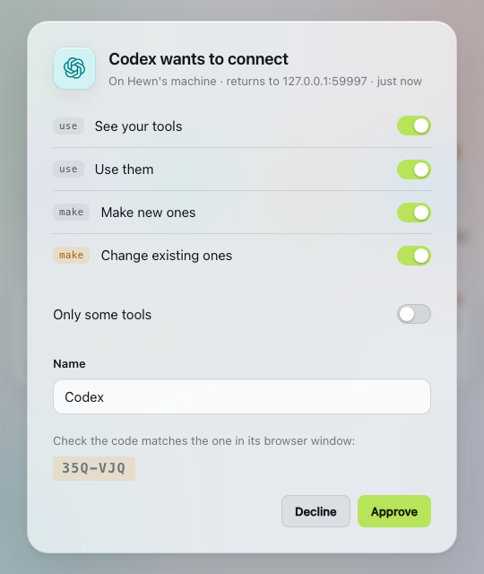

# Connecting agents

Agents connect to Hewn over MCP and sign in with OAuth. Each one shows up in Hewn as a request with a short code. You check that the code matches the one in the agent's browser window, choose what it may do, and approve it. Hewn never writes a token into an agent's config, and you can disconnect an agent at any time: it's cut off on its next call.

You can approve in three places:
- the web client: the **Inbox**, on the right of the top bar
- the terminal: `hewn agents pending`, then `hewn agents approve <code>`
- inside `hewn setup`, which asks you right there



## Claude Code, Codex and OpenCode (on the same machine)

```sh
hewn setup
```

Or, in the web client: **Agents → Add… → An agent that uses your tools**. For each one, Hewn:
- **Claude Code:** registers Hewn (`claude mcp add … hewn http://127.0.0.1:7717/mcp`), then signs it in (`claude mcp login hewn`).
- **Codex:** adds a pointer to `~/.codex/AGENTS.md` (Codex needs it to think of Hewn), then `codex mcp add hewn --url …`, which signs it in.
- **OpenCode:** registers Hewn in its global config (`opencode mcp add hewn --url …`, in `~/.config/opencode/opencode.json`), adds a pointer to `~/.config/opencode/AGENTS.md` (OpenCode reads that, not Hewn's own description), then signs it in (`opencode mcp auth hewn`). If you had no `~/.config/opencode/AGENTS.md` before, OpenCode now reads it instead of `~/.claude/CLAUDE.md`: move any rules you kept there.

Each one also gets the Skill **build a Hewn tool** (see [Tools an agent writes itself](#tools-an-agent-writes-itself)) in its skills folder: Claude Code in `~/.claude/skills/build-a-hewn-tool/`, Codex and OpenCode in `~/.agents/skills/build-a-hewn-tool/`. Setup writes it again each time, and so does `hewn upgrade` for every agent set up with Hewn, so it matches your Hewn; Hewn never touches the other skills there. An agent set up by an older Hewn gets it when you set it up again (or on the next upgrade).

Start a new agent session afterwards, so it sees the tools.

The same agent can also [build your tools](concepts.md#hewns-two-jobs). The last step of connecting it offers that, or choose later in Settings › AI.

## claude.ai, Claude Desktop and ChatGPT

Cloud agents can't reach `127.0.0.1`: they need Hewn on an address the internet can reach. Claude Desktop is one of them: its connectors are reached from Anthropic's cloud, even with Hewn on the same Mac.

**The easy way: your public URL.** If Hewn runs on a machine that's always on, follow [Using Hewn from anywhere](remote-access.md) first. You get one address for everything (`https://hewn.example.com`), and the connector address is `https://hewn.example.com/mcp`. It stays the same across restarts.

Then:

1. **claude.ai or Claude Desktop:** Settings → Connectors → Add custom connector. **ChatGPT:** Settings → Connectors → Create (developer mode). Paste the `/mcp` address, and leave the OAuth client fields empty.

   Claude Desktop and the Claude mobile apps use the same connectors as claude.ai: add Hewn once, on claude.ai or in Claude Desktop, and it shows up in all of them. The mobile apps can't add one.
2. Connect. The page asks you to approve it in Hewn: check the code, and approve.
3. **Tell it to look in Hewn.** Cloud agents don't use the instructions Hewn sends, so add the pointer to claude.ai's Settings → Profile (personal preferences), or ChatGPT's custom instructions. The web client has it ready to copy (Agents → Add… → claude.ai or ChatGPT):

   ```
   ## Hewn
   My personal data and tools (e.g. activity logs, trackers) live in the `hewn` MCP server.
   When I ask about myself, my activities or my records, look there first: search for and use the hewn tools.
   ```

### Without a public URL: a tunnel

To try a cloud agent without setting up a domain, Hewn can open a tunnel to a separate listener. There, only MCP and the sign-in pages answer: never the web client, tool UIs or admin. Requests there are rate limited and logged.

1. Install `cloudflared` (macOS: `brew install cloudflared`; Linux: [Cloudflare's packages](https://developers.cloudflare.com/cloudflare-one/connections/connect-networks/downloads/)).
2. `hewn tunnel start --quick`. It prints an `https://….trycloudflare.com` address and the connector address, `…/mcp`.
3. Add the connector as above.

A **quick tunnel** gets a new address every time it starts, including when Hewn restarts, and you then have to update the connector. For a stable address without a reverse proxy:
- **Named cloudflared tunnel** (a Cloudflare account and a domain):
  1. `cloudflared tunnel login`
  2. `cloudflared tunnel create hewn`
  3. `cloudflared tunnel route dns hewn hewn.example.com`
  4. `hewn tunnel start --cloudflared hewn --hostname hewn.example.com`
- **Tailscale Funnel:** `hewn tunnel start --tailscale` (Funnel must be enabled for your tailnet; not yet tested).

The tunnel runs with Hewn and comes back when Hewn restarts. `hewn tunnel status` shows it, and `hewn tunnel stop` closes it.

## Any other MCP client

Add Hewn as a **streamable HTTP** MCP server at `http://127.0.0.1:7717/mcp`, or through the tunnel. It signs in with OAuth (dynamic client registration and PKCE), and you approve it. Clients that only support static bearer tokens can't connect.

## What agents can do

When you approve an agent, you choose its scopes. You can narrow what it asked for, never widen it:

| Scope | Lets it |
| --- | --- |
| See | list your tools and read their contracts |
| Use | call operations |
| Make | ask for new tools (the builder builds them) |
| Change | ask for changes to existing ones |

You can also limit it to **some tools**. Later, click the agent on **Agents** to turn scopes off and back on, within what you approved, or to disconnect it. To give it more, disconnect it and let it ask again.

**Its new tools and changes** (its approval mode, on the same sheet): a new tool an agent makes, or a change to one you have, waits for your approval once it passes its checks, whether Hewn's builder wrote it or the agent did. The Inbox shows it with what it adds, what else changes, the files it changes and the screen after the change, on a desktop and a phone, light and dark. So does opening the tool, whose tile says it needs you: **Later** opens the tool as it is. A new tool shows what agents can do with it, its screen and its files. **Go live after the checks** is shown but can't be chosen yet: it comes once Hewn's own tests guard your data. Whatever the mode, what a tool asks for (a host, a key, another tool, a model) waits for you, as it always has: it can't run, reach the network or start a schedule until you approve it.

Whatever their scopes, agents can't approve grants or secrets, enable schedules, or manage other agents. Those are yours. When an agent calls an operation marked **destructive**, it waits until you allow it (once) in Hewn: a banner shows on every page until you answer.

## What agents see

Agents get a small set of MCP tools: list your tools and read their operations, call an operation, ask for a new tool or a change, write one itself (below), follow a build, propose a schedule, ask for access, and show a tool's widget right in the chat (in clients that support MCP Apps). Every agent can also read Hewn's own docs (`hewn_docs`): ask one how something in Hewn works, and it answers from these pages instead of guessing. The full list is in [the agent spec](../spec/agents.md).

## Tools an agent writes itself

An agent with **Make** or **Change** can write a tool in its own folder instead of asking Hewn's builder, and hand it to Hewn. Claude Code in a repo of yours, say, or an agent on another computer. Hewn checks it exactly as it checks its own builder's work, so the agent writing it never decides what goes live:

1. **The pack** (`capabilities_pack`): what Hewn's builder finds in its workspace besides your request. Your [instructions for building](building-tools.md#instructions) (for every tool, and for a change the tool's own), your other tools' contracts (only the tools the agent may see), their looks, so the new one looks different, and Hewn's design system; for a change, the tool's files as they are now and its schedules. Never your conversations with Hewn or your data. An agent with a shell downloads the pack as a zip and unzips it into its workspace (its own folder): the link is made for that agent inside its signed-in call and works once, for 10 minutes. One without a shell reads the pack a page at a time.
2. **The check** (`capabilities_check`), as often as it likes while it works, up to 30 an hour: the checks a build gets, with what failed and pictures of its screen at 1280 and 390 px, light and dark (the top of a long page, the rest if it asks). Nothing goes live. Its migrations run on a copy of your data only once it submits.
3. **The submission** (`capabilities_submit`): a build like any other, with "submitted by" and the agent's name on its page, in Activity and on the version. Once it passes, a new tool or a change waits for your approval (above).

Agents learn how from the Skill **build a Hewn tool**: the brief Hewn's own builder works from, with these three steps in place of its folder. An agent you set up from Hewn has it in its skills folder (above); any agent connected to Hewn finds it through `hewn_docs`; another that loads skills from files can take it from `<your Hewn>/_platform/skills/build-a-hewn-tool/SKILL.md`, or from the npm package (`dist/skills/`).

A submission carries the tool's own files only. Files Hewn never keeps in a tool (a builder's settings such as `.claude/` or `CLAUDE.md`, `AGENTS.md`, other dotfiles, the pack's own files, screenshots) are refused with the rule named, never dropped quietly, and so is anything over 5 MB. A change is refused while another change to the tool is on its way, or when the tool has moved on since the agent's pack.

## CLI reference

```
hewn agents                     connected agents
hewn agents pending             requests waiting for you, with their codes
hewn agents approve <code> [--scopes discover,invoke] [--name <name>] [--only <id>,<id>]
hewn agents deny <code>
hewn agents scopes <agent> discover,invoke
hewn agents revoke <agent>
hewn tunnel [status|start …|stop]
```
