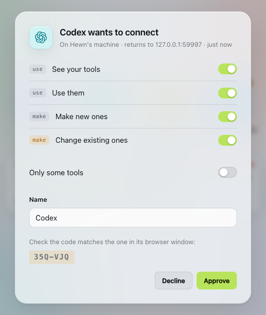

# Connecting agents

Agents connect to Hewn over MCP and sign in with OAuth. Each one shows up in Hewn as a request with a short code. You check that the code matches the one in the agent's browser window, choose what it may do, and approve it. Hewn never writes a token into an agent's config, and you can disconnect an agent at any time: it's cut off on its next call.

You can approve in three places:
- the web client: the **Inbox**, on the right of the top bar
- the terminal: `hewn agents pending`, then `hewn agents approve <code>`
- inside `hewn setup`, which asks you right there



## Claude Code and Codex (on the same machine)

```sh
hewn setup
```

Or, in the web client: **Agents → Add… → An agent that uses your tools**. For each one, Hewn:
- **Claude Code:** registers Hewn (`claude mcp add … hewn http://127.0.0.1:7717/mcp`), then signs it in (`claude mcp login hewn`).
- **Codex:** adds a pointer to `~/.codex/AGENTS.md` (Codex needs it to think of Hewn), then `codex mcp add hewn --url …`, which signs it in.

Start a new agent session afterwards, so it sees the tools.

The same agent can also [build your tools](concepts.md#hewns-two-jobs). The last step of connecting it offers that, or choose later in Settings › AI.

## claude.ai and ChatGPT

Cloud agents can't reach `127.0.0.1`: they need Hewn on an address the internet can reach.

**The easy way: your public URL.** If Hewn runs on a machine that's always on, follow [Using Hewn from anywhere](remote-access.md) first. You get one address for everything (`https://hewn.example.com`), and the connector address is `https://hewn.example.com/mcp`. It stays the same across restarts.

Then:

1. **claude.ai:** Settings → Connectors → Add custom connector. **ChatGPT:** Settings → Connectors → Create (developer mode). Paste the `/mcp` address, and leave the OAuth client fields empty.
2. Connect. The page asks you to approve it in Hewn: check the code, and approve.
3. **Tell it to look in Hewn.** Cloud agents don't use the instructions Hewn sends, so add the pointer to claude.ai's Settings → Profile (personal preferences), or ChatGPT's custom instructions. The web client has it ready to copy (Agents → Add… → claude.ai or ChatGPT):

   ```
   ## Hewn
   My personal data and tools (e.g. activity logs, trackers) live in the `hewn` MCP server.
   When I ask about myself, my activities or my records, look there first: search for and use the hewn tools.
   ```

### Without a public URL: a tunnel

To try a cloud agent without setting up a domain, Hewn can open a tunnel to a separate listener. There, only MCP and the sign-in pages answer: never the web client, tool UIs or admin. Requests there are rate limited and logged.

1. Install `cloudflared` (macOS: `brew install cloudflared`; Linux: [Cloudflare's packages](https://developers.cloudflare.com/cloudflare-one/connections/connect-networks/downloads/)).
2. `hewn tunnel start --quick`. It prints an `https://….trycloudflare.com` address and the connector address, `…/mcp`.
3. Add the connector as above.

A **quick tunnel** gets a new address every time it starts, including when Hewn restarts, and you then have to update the connector. For a stable address without a reverse proxy:
- **Named cloudflared tunnel** (a Cloudflare account and a domain):
  1. `cloudflared tunnel login`
  2. `cloudflared tunnel create hewn`
  3. `cloudflared tunnel route dns hewn hewn.example.com`
  4. `hewn tunnel start --cloudflared hewn --hostname hewn.example.com`
- **Tailscale Funnel:** `hewn tunnel start --tailscale` (Funnel must be enabled for your tailnet; not yet tested).

The tunnel runs with Hewn and comes back when Hewn restarts. `hewn tunnel status` shows it, and `hewn tunnel stop` closes it.

## Any other MCP client

Add Hewn as a **streamable HTTP** MCP server at `http://127.0.0.1:7717/mcp`, or through the tunnel. It signs in with OAuth (dynamic client registration and PKCE), and you approve it. Clients that only support static bearer tokens can't connect.

## What agents can do

When you approve an agent, you choose its scopes. You can narrow what it asked for, never widen it:

| Scope | Lets it |
| --- | --- |
| See | list your tools and read their contracts |
| Use | call operations |
| Make | ask for new tools (the builder builds them) |
| Change | ask for changes to existing ones |

You can also limit it to **some tools**. Later, click the agent on **Agents** to turn scopes off and back on, within what you approved, or to disconnect it. To give it more, disconnect it and let it ask again.

Whatever their scopes, agents can't approve grants or secrets, enable schedules, or manage other agents. Those are yours. When an agent calls an operation marked **destructive**, it waits until you allow it (once) in Hewn: a banner shows on every page until you answer.

## What agents see

Agents get a small set of MCP tools: list your tools and read their operations, call an operation, ask for a new tool or a change, follow a build, propose a schedule, ask for access, and show a tool's widget right in the chat (in clients that support MCP Apps). The full list is in [the agent spec](../spec/agents.md).

## CLI reference

```
hewn agents                     connected agents
hewn agents pending             requests waiting for you, with their codes
hewn agents approve <code> [--scopes discover,invoke] [--name <name>] [--only <id>,<id>]
hewn agents deny <code>
hewn agents scopes <agent> discover,invoke
hewn agents revoke <agent>
hewn tunnel [status|start …|stop]
```
