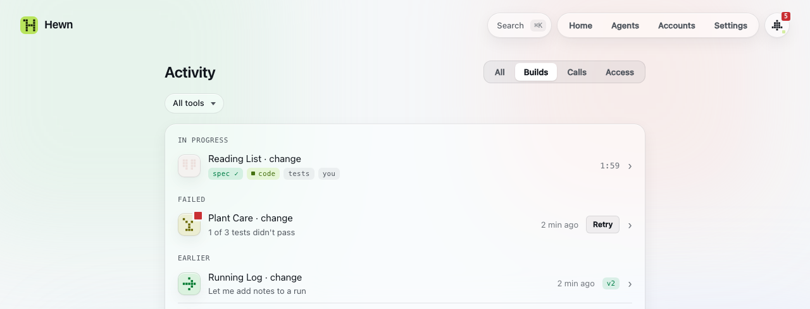
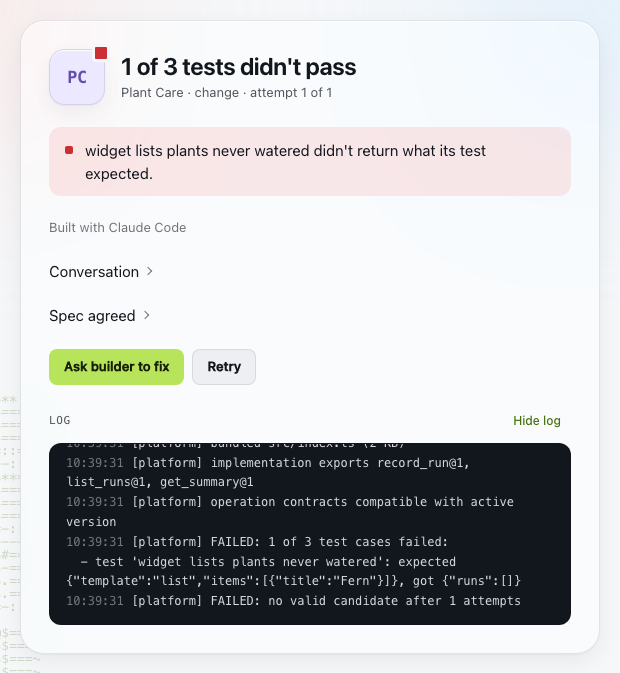
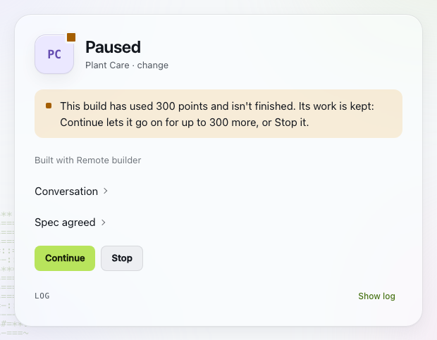
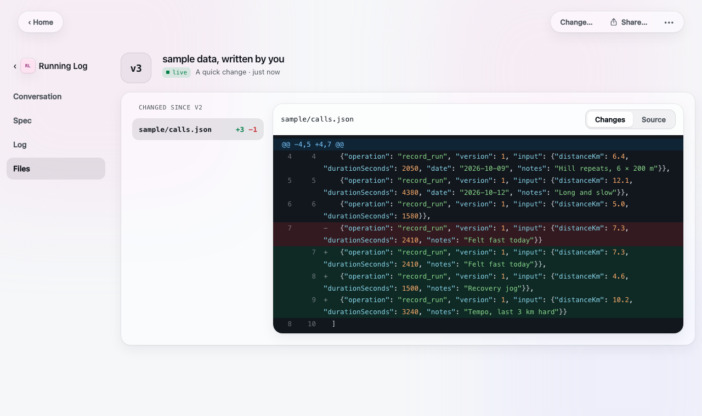

# Building tools

You don't write tools yourself. You describe what you want, Hewn might ask a few clarifying questions, then proposes a spec, and your coding agent builds it.

## Asking for a tool

In the web client: the **New** tile on Home, or press `n`. Describe it in plain words:

> A habit tracker. Ask me each evening which habits I did, and show the streak.

Paste a screenshot (Ctrl+V / ⌘V), drop files on the box, or **Attach**: a screenshot of the screen to change or the look you mean, a sketch, a script to port, data to import. Images (up to 5 per message, resized before they go up) and text files (up to 256 KB each) go with your message to the intake and, when you build, to the builder, in its workspace. They stay with the build, like the conversation.

The agent that [builds your tools](concepts.md#hewns-two-jobs) (Settings › AI) first talks it through: it asks until the request is clear (when you'd use it, what it keeps, the main action), each question with the default it would assume, so "ok" answers them all; **Draft now** skips the rest and takes its assumptions, listed with the proposal. Then it makes a **spec proposal**: the tool, what it will do, what it needs (a site to reach, a key, another tool, a model: its [grants](concepts.md#grants)), and any widgets or [schedules](concepts.md#schedules). For a new tool the spec is a short brief, not a list of operations: what it's for, what it keeps, what you decided together, what it needs and how it should feel. The builder designs the operations and the screen from it and from your own words, so the card shows what it keeps and what's decided; **Show brief** has the whole brief. A big request can become a few small tools that work together; untick the ones you don't want. Reply to change it, or press **Build** (it says how many tools: "Build 1 tool").


Leave in the middle (to look something up in Activity, say) and come back, with Back or **New**: the conversation is where you left it in that browser tab, with what you'd typed and not sent, its last proposal ready to build. A reply still on its way when you left arrives there (or why it failed). It stays until you build from it or start a new one with **+ New** (top right, and it asks first; in a tool's **Change…** panel, next to ×), which keeps its own the same way. Opening one with its text already in the box (Info's **Change it**, **Ask builder to fix this**, **Ask builder** in Share…, Home's box) starts a new conversation too: the one kept is replaced once you send it. A conversation picked up with **Continue** isn't kept. While the intake is answering, **Send** is a stop button: it ends the run there and then, and your message goes back in the box with **Stopped.** above it; the note goes once you send again.

You can ask the box about Hewn too ("can a tool read my calendar?", "how do I undo a change?"): it answers from Hewn's docs instead of drafting, and says so when they don't cover it. Reply to carry on ("ok, draft one"). It sticks to Hewn: trivia, or something Hewn doesn't build (a Claude skill, a browser extension), gets a line saying so, and a tool if one would do.

You can also ask an agent ("make me a reading list in Hewn"), if you allowed it to make tools ([scopes](agents.md#what-agents-can-do)). It shows up the same way.

## The build

The agent [builds it](concepts.md#hewns-two-jobs) (Claude Code, Codex or OpenCode on your machine, in a sandbox, on however it's signed in: a subscription, an API key, a cloud provider such as Amazon Bedrock or Google Vertex AI, or with OpenCode a local model server) writes the tool. It works from the spec and, for a tool you asked for in the chat, from your conversation with the intake too, in your own words: where the spec is silent or vague, or you changed your mind along the way, what you said wins, within your [instructions](#instructions) and Hewn's rules for tools. The request is in `BUILDER.md`, Hewn's brief (how to build a tool for Hewn) in `BRIEF.md` next to it, which the builder is told to read whole before it writes anything, and the conversation in `OWNERS_WORDS.md`: each a file of its own, so none pushes another out of what the builder reads.

The screen gets the most care. Before writing it, the builder works out when you'll open the tool and what you want to see first, and draws that big at the top. For a new screen or a requested redesign, it writes out a short design plan, explores three directions and picks a look of its own: a palette from its subject (green for plants or money, purple for sleep) for light and dark on a neutral page (white or pale grey, black or near-black grey in dark), its own type, a layout that suits the task, and your data drawn as a picture (a timeline, a ring, a calendar) rather than a form. It records the look in `ui/look.json`. A change keeps a tool's look unless you ask for a new one, but turns a tinted page neutral.

To tell a new tool apart, Hewn gives the builder each of your other tools, in a file next to its brief (`OTHER_TOOLS.md`): its colour on Home and the look its builder recorded in `ui/look.json`, up to 700 characters of it. The new one must look clearly different from them, by its concept, layout, type and signature visual. Its colour comes from its subject when the subject has one (green for plants, purple for sleep), even if another tool shares it; a tool whose subject has none (people, plans, words, time) gets a hue at least 40° from every other tool's (on a crowded Home, the middle of the widest gap between them), so its tile stands apart on Home. The builder draws that tile's icon (a 5×5 glyph) first, once it has read your words and the other tools' looks, so Home shows it while it builds; a retry or a change keeps the icon and colour a tool has unless you ask for new ones. A tool built before 0.4.10 has no recorded look, so it's listed with its colour only, until a change records its look. Connections have no screen, so they aren't listed.

So it can build on your other tools (a Weekly Review reading Running Log's runs, say) instead of keeping copies, the builder also gets what each of them offers. Its brief names them; `CONTRACTS.md` next to it lists each one's operations (the newest version of each), and `.hewn-contracts/<id>.md` has each one's full contract, read when the builder calls that tool. A change also sees the older versions its tool calls today. No line in what Hewn writes for the builder is longer than 1,000 characters (OpenCode cuts a line at 2,000): a schema too long for one line is written over several, and any other long line is wrapped.

As it works, the builder checks its own work: its `check` tool runs what Hewn runs below, without making anything live, and shows it its screen filled with its sample data on a desktop and a phone, light and dark (the top of a long page), with what to fix measured on it (what sticks out past the phone's edge, text cut short, things drawn over each other, buttons that break the page). It fixes what it finds and checks again until the check passes, so fewer builds need another attempt. The build's activity shows each check ("Checking its work (1 of 10)", "Check: 2 problems to fix"), up to 10 an attempt. The tool runs in the builder's sandbox and reaches Hewn only through files in the build's folder: no port, no key.

Then Hewn:

1. checks the manifest and the contracts
2. runs the tool's tests, and its database migrations on a copy of your data
3. renders its screen, empty and filled with its sample data (a new tool with a screen needs some), on a desktop and a phone screen, and checks it loads without errors
4. for a new tool with a screen (or a [Polish](#polishing-a-tool)), has the builder look at its screen again, twice (below)
5. makes it live if all of that passes

**A second look, for a new tool.** Once a new tool passes its checks, the builder carries on with screenshots of it filled with its sample data, on a desktop and a phone, light and dark, the whole page (a long one in parts it can read):

- **Reviewing the design:** it writes down the five biggest problems it sees, as a demanding designer would (what the eye lands on first, how generic it looks, how the data is drawn, the phone, dark mode), and fixes them. It holds the screen against what you said and against your other tools' looks too.
- **Fixing details:** fresh screenshots, with what Hewn measured on them (what sticks out past the phone's edge, text cut short, things drawn over each other, buttons that break the page): it fixes those without redesigning anything.

Each goes through the same checks again, with a second try if it doesn't pass them. If it still doesn't, the build fails like any other: it says which step and what failed ("Reviewing the design: 1 of 6 tests didn't pass"), nothing goes live, and **Retry** or **Ask builder to fix** builds it again. A build the host pauses during one is paused as at any other point. Changes and installs don't get one; a tool you already have gets one when you [polish it](#polishing-a-tool). The build's steps show each as it runs ([A build](using-hewn.md#a-build)).
What you ask for goes live right after the checks. A change an agent makes to a tool you have waits for your approval first: see [Changes made by agents](#changing-a-tool).

Builds show in Activity and the Inbox while they run, with their milestones. A build usually takes a few minutes; a new tool's second look adds about as much again, in time and in your builder's usage.

When you next open the tool, a quiet strip at its foot asks once per version, within a week of the build: **Got what you asked for?** Yes, Not quite (which opens the change panel, so what's off becomes the next change), or skip. Your answer stays in your Hewn; nothing is sent anywhere. `hewn feedback` lists recent builds with your answers and what the record shows (a failed build whose retry went live; another change within a day of going live, which is what **Ask builder to fix this** makes; a restore within a week; the tool deleted within a day), so you can see which builds work out and which don't.

The build page keeps what led to the build: **Spec agreed** opens the spec the builder works from, and **Conversation** what you and the intake said. Both stay with the version it made, along with the builder's log, for the tool's life. A failed or cancelled build's page shows them too.



When it's live, the tool may still need you: **Allowed to** on its Info lists the [grants](concepts.md#grants) it asked for (a host such as `api.met.no`, a key, another tool's operations, a model). It isn't ready until you authorize them, and the Inbox says so. You can revoke any of it later. A setting it asks for (a server address, a repository) may come with a suggested value already in its field: check it and save, or type another. Nothing is filled in for you until you save. (Builders write that value as `suggested` on the setting, never as a `default`.)

## Changing a tool

**Change…** (in the tool's bar, its menu, or Info's **Change it** box) opens a panel next to the tool, so you can describe the change while you look at it; drag its left edge to make it wider. The tool keeps running its current version while the change builds. When the new version is live, **Reload** shows it, and **Undo** goes back to the one before.

The proposal for a change is a short brief too: what changes, what must keep working (the operations agents and other tools call today, and the data), what you decided, what it needs and what should look or feel different. The card shows what changes and what's decided; **Show brief** has the whole brief. The builder designs any new operations from it and from your own words, and must keep the existing ones working: Hewn's checks refuse a version that breaks one. A change to a connection still lists the operations it adds.

Changes to one tool take turns: ask for another while one builds (or an agent does) and it waits, then starts from the version the first one leaves, whether that one goes live or fails. An agent's change waiting for your approval doesn't hold the next one up. The box and your agents see the changes on their way, so the next one builds on them instead of asking for the same thing again.

Text Hewn puts in the box for you (**+ Ask for one** under Widgets puts "Suggest some widgets.", **Polish…** "Polish it.", **Ask builder to fix this** what failed) waits there for you to add to and send; nothing goes to the intake until you do.

A tool without a screen of its own shows its operations as forms. **Give it a proper screen** asks for one.

Some changes need no builder: picking another model tier, for example, is a new version right away.

**Changes made by agents:** an agent's change to a tool you have waits for you once it passes its checks (the Inbox, or `hewn review`), whether Hewn's builder wrote it for the agent or the agent wrote it itself ([agents.md](agents.md#tools-an-agent-writes-itself)). Its card shows what it adds, what else changes, the files it changes and the screen after the change (a desktop and a phone, light and dark); **Allow** makes it live, **Don't allow** leaves the tool as it is. This is the agent's **approval mode**, under its row on Agents: in this release its changes always wait, and **go live after the checks** comes once Hewn's own tests guard your data. A new tool an agent asks for or writes goes live after its checks, and any new grants still wait for you.

## Polishing a tool

**Polish…** in the menu of a tool with a screen of its own gives a tool you already have the second look a new tool gets ([above](#the-build)): **Reviewing the design**, then **Fixing details**, on screenshots of its screen filled with its sample data. It's for tools built before 0.4.10, which never had one. The tool keeps what it does and its character (its concept, its colour and the palette in `ui/look.json`), though a tinted page turns neutral (white or pale grey, black or near-black grey in dark); the builder lifts what the eye lands on first, the details and how your data is drawn.

It opens the tool with the [change panel](#changing-a-tool), "Polish it." in the box: add what you'd like ("the count should lead", "try a bolder, darker look") and send it. The intake answers with a **Polish** proposal: what it will look at, and a note for the builder with what you asked; a new look only when you ask for one. **Build polish** on the proposal starts it, and the panel follows the build as for any change. Ask for something that changes what the tool does and the intake drafts a change instead. A tool without a screen of its own has no **Polish…**: ask for a polish in its change panel and the intake says there's nothing to polish, and offers to give it a screen (a connection never has one).

The design review holds the screen against what you asked for: the builder gets your conversations with the intake that led to the tool as it is (the one that asked for it, then each change you talked through), oldest first, in `OWNERS_WORDS.md` as for a new tool, with the conversation that asked for the Polish last, as your latest word. A change you undid with **Restore** isn't in it. Hewn has kept conversations since 0.4.6 (late October 2026), so an older tool, or one an agent asked for, has none to give.

A tool without sample data gets some first: the builder writes `sample/calls.json` (made-up entries that show what the tool does, as a new tool has), Hewn checks it, then the two passes carry on in the same session. A tool that has sample data goes straight to them. Either way it's a longer build than a change, about as long as a new tool's second look.

**Show the builder my own data**, on the proposal of a tool with data of its own, is off unless you tick it. Ticked, the screenshots show the tool filled with a copy of your own entries instead of its sample data, which can say more about a tool you use every day; the builder's AI model then sees them, as it sees everything else in the build. It's told they're private and to keep them out of the tool's files (its sample data, tests and text stay made up). Its own checks while it works still use the sample data, and your data itself isn't touched.

If a pass fails, the build fails like any other: nothing goes live, the tool stays on the version it had, and **Retry** or **Ask builder to fix** polishes it again. Polish needs a tool with a screen, and only you can start it, since it costs more than a change and the choice about your data is yours: agents can't, though they can still ask for a change.

## Instructions

Standing rules for how your tools are built, which the builder reads on every build: for every tool ("Swedish copy in every screen", "never a delete button without Undo") or for one tool ("keep it to a single screen"). Tell the intake a rule while you talk a request through and it remembers it: the chat shows **Saved as a rule:** (or **Saved as a rule for** the tool) with the rule as it was written down, and **Undo** if that's not what you meant. Withdraw a rule the same way.

They're yours to read and edit, one rule per line: Settings › AI › **Instructions for building** for every tool, and a tool's Info › **Instructions** for that tool, where **Remove** takes one out and the line under them adds one. Each build records the instructions it ran with, next to its conversation and spec.

## When a build fails

The build says why: a failing test, an invalid manifest, an error on its screen (with a screenshot of it as it broke). Its log is open below. **Ask builder to fix** starts a new attempt that gets the failure as context. Your tool, if it already existed, keeps running the version it had.

A build gets up to three attempts on its own (Settings › AI › Build attempts). A later attempt picks up where the builder left off, with the failure, instead of starting over, so it takes a fraction of the first.



A host's builder can also **pause** a build part-way, with its work kept: for example once the build has used its allowance. The build says so in the host's words, with **Continue** (it carries on from where it stopped) and **Stop**. It waits in the Inbox until you choose, and so do changes to that tool, also ones asked for after it paused (they queue behind it); Hewn doesn't carry on by itself, and an agent can't continue it for you. A new tool that's paused keeps its name: asking for it again (or installing one by that name) says it's paused.



If the builder itself can't work (signed out, out of usage), Hewn stops instead of retrying. Sign it in again (`claude`, `codex login` or `opencode auth login`), then try again.

A new tool that failed or that you cancelled doesn't hold on to its name: ask for it again (or build the same proposal) and the new build takes it over. **Retry** on the old build is refused while the new one is being built, works again if the new one fails or you cancel it, and once the new one is live says the tool has been created since. A build that waited for the old one (a tool that calls it) follows the new one when you retry it.

## Versions

Every change is a new version. Your data stays and moves forward with each one. Info shows the last two; **All versions** (or **Versions** in the tool's menu) lists every one. **Details** opens a version; **Restore…** there makes it active again (it asks first), with the data kept. Restoring is refused if a newer version changed the data in a way the older code can't read.

A version's page shows what led to it: the conversation with the intake, the spec and the builder's log, each in the menu on the left, under the tool (back to its Info). **Files** shows its code: **Changes** lists what changed since the version it was built on (the one before, or the one restored before the change), each file as a diff (added lines green, removed lines red, with both line numbers), and **Source** shows every file as it is, in syntax colours (JSON written compactly is laid out, or **As written**). A long file shows its first 5,000 lines. **Continue from here** opens a change with that conversation on top, so you pick up where you left off instead of explaining the tool again; opening **Change…** on a tool offers the same ("Continue from the last conversation?").



Operations are versioned too (`list_runs@1`). A breaking change adds `list_runs@2` next to the old one, so agents and other tools that use `@1` keep working.

## Deleting a tool

**Delete…** in the tool's menu removes it from Hewn and from agents, but keeps its data (you type its id to confirm). Settings › Data › Deleted tools lists what you deleted: **Restore** brings it back with its data, and **Delete forever** removes the code, versions, data, logs and secrets (you type its name to confirm). After that, only a backup can bring it back.

## From the terminal

```
hewn status [--json]           tools, and whether Hewn is idle
hewn watch [buildId]           follow a build live
hewn feedback [--days N]       how recent builds worked out (--json for the data)
hewn review                    agents' changes waiting for you
hewn rollback <id> [version]   an earlier version, active again
hewn restore <id>              bring back a deleted tool
hewn purge <id>                delete a deleted tool forever
hewn install <dir | file>      install a tool from a folder, or a file someone shared
hewn share <id>                a tool as a file to give someone (see Sharing tools)
hewn data reset <id>           Start over: empty a tool's data, keep the tool
```

To read or write a tool's code yourself, see [Writing tools](capabilities.md).
