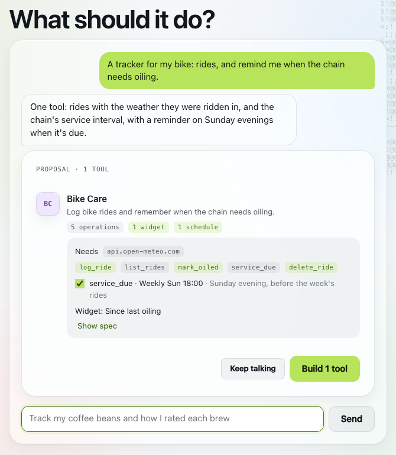
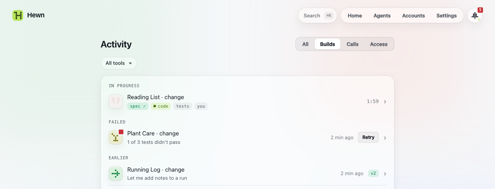
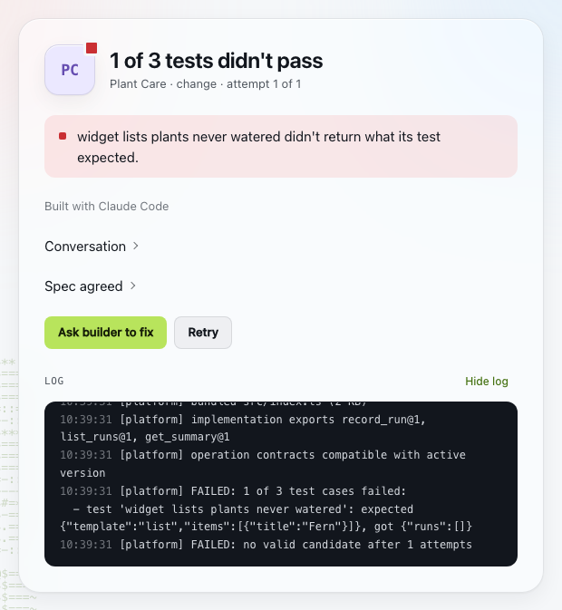

# Building tools

You don't write tools yourself. You describe what you want, Hewn might ask a few clarifying questions, then proposes a spec, and your coding agent builds it.

## Asking for a tool

In the web client: the **New** tile on Home, or press `n`. Describe it in plain words:

> A habit tracker. Ask me each evening which habits I did, and show the streak.

The agent that [builds your tools](concepts.md#hewns-two-jobs) (Settings › AI) first talks it through: it asks what it needs to know, then makes a **spec proposal**: the tool, what it will do, what it needs (a site to reach, a key, another tool, a model: its [grants](concepts.md#grants)), and any widgets or [schedules](concepts.md#schedules). A big request can become a few small tools that work together; untick the ones you don't want. Reply to change it, or press **Build** (it says how many tools: "Build 1 tool").



You can also ask an agent ("make me a reading list in Hewn"), if you allowed it to make tools ([scopes](agents.md#what-agents-can-do)). It shows up the same way.

## The build

The agent [builds it](concepts.md#hewns-two-jobs) (Claude Code or Codex on your machine, in a sandbox, on however it's signed in: a subscription, an API key, or a cloud provider such as Amazon Bedrock or Google Vertex AI) writes the tool. Then Hewn:

1. checks the manifest and the contracts
2. runs the tool's tests, and its database migrations on a copy of your data
3. renders its screen and checks it loads without errors
4. makes it live if all of that passes

What you ask for goes live right after the checks. A change an agent asks for that adds operations or touches a [connection](connections.md) waits for your approval first: see [Changes made by agents](#changing-a-tool).

Builds show in Activity and the Inbox while they run, with their milestones. A build usually takes a few minutes.

The build page keeps what led to the build: **Spec agreed** opens the spec the builder works from, and **Conversation** what you and the intake said. Both stay with the version it made, along with the builder's log, for the tool's life.



When it's live, the tool may still need you: **Allowed to** on its Info lists the [grants](concepts.md#grants) it asked for (a host such as `api.met.no`, a key, another tool's operations, a model). It isn't ready until you authorize them, and the Inbox says so. You can revoke any of it later.

## Changing a tool

**Change…** (in the tool's bar, its menu, or Info's **Change it** box) opens a panel next to the tool, so you can describe the change while you look at it. The tool keeps running its current version while the change builds. When the new version is live, **Reload** shows it, and **Undo** goes back to the one before.

A tool without a screen of its own shows its operations as forms. **Give it a proper screen** asks for one.

Some changes need no builder: picking another model tier, for example, is a new version right away.

**Changes made by agents:** an agent's change that adds operations, or changes a connection, waits for you to approve it (the Inbox, or `hewn review`). You see what it adds before it goes live. Other changes go live after their checks, and any new grants still wait for you.

## When a build fails

The build says why: a failing test, an invalid manifest, an error on its screen. Its log is open below. **Ask builder to fix** starts a new attempt that gets the failure as context. Your tool, if it already existed, keeps running the version it had.



If the builder itself can't work (signed out, out of usage), Hewn stops instead of retrying. Sign it in again (`claude` or `codex login`), then try again.

## Versions

Every change is a new version. Your data stays and moves forward with each one. **Versions** (Info, or the tool's menu) lists them; **Restore** makes an earlier one active again, with the data kept. Restoring is refused if a newer version changed the data in a way the older code can't read.

Under each version is what led to it: the conversation with the intake, the spec and the builder's log. **Continue from here** opens a change with that conversation on top, so you pick up where you left off instead of explaining the tool again; opening **Change…** on a tool offers the same ("Continue from the last conversation?").

Operations are versioned too (`list_runs@1`). A breaking change adds `list_runs@2` next to the old one, so agents and other tools that use `@1` keep working.

## Deleting a tool

**Delete…** in the tool's menu removes it from Hewn and from agents, but keeps its data. Settings › Data › Deleted tools lists what you deleted: **Restore** brings it back with its data, and **Delete forever** removes the code, versions, data, logs and secrets (you type its name to confirm). After that, only a backup can bring it back.

## From the terminal

```
hewn status                    tools and recent builds
hewn watch [buildId]           follow a build live
hewn review                    agents' changes waiting for you
hewn rollback <id> [version]   an earlier version, active again
hewn restore <id>              bring back a deleted tool
hewn purge <id>                delete a deleted tool forever
hewn install <dir>             install a tool from a folder
```

To read or write a tool's code yourself, see [Writing tools](capabilities.md).
