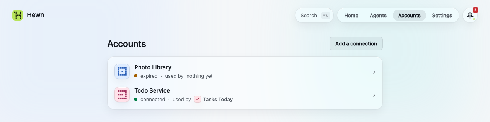
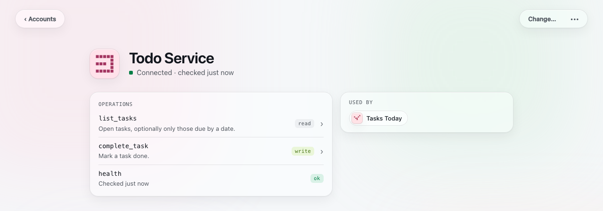

# Connections

A **connection** is a [tool](concepts.md#tools) that wraps one service you have an account with: Todoist, GitHub, Notion, your bank, a server at home. It's the only kind of tool that holds credentials. Other tools reach the service through the connection's [operations](concepts.md#tools), so a tool can do exactly what those operations allow: a GitHub connection without `delete_repo` can't delete a repository.

Connections are on **Accounts**.

## Getting one

Mention the service when you ask for a tool:

> Put my overdue Todoist tasks on Home.

The proposal says it **needs a new connection**, and Hewn builds the connection first, then the tool that uses it. Or start from the connection: **Accounts → Add a connection**, name the service, and describe what you want from it.

When it's built, the connection asks you for what it needs (its [grants](concepts.md#grants)):
- **hosts** it may reach, such as `api.todoist.com`
- **a key** (API token), with where to find it in the service
- **settings** that aren't secret, such as your server's address
- **a sign-in**, for services that use a login flow instead of a pasted key: Hewn walks you through it step by step

Keys are stored encrypted, with the secrets key in your Keychain (macOS) or keyring (Linux), and passed to the connection per call. No tool or agent ever sees them, and a result that contains one is withheld.

## Health

Each connection reports its health: **connected**, **expired** (sign in again) or **broken**. Accounts shows it for each, with the tools that use the connection. When one needs you, it's in the Inbox too.



## A connection's page

Click a connection on Accounts:
- **Operations:** run any of them from a form, including `health`
- **Used by:** the tools that call it
- **Settings**, when it has any: sign in again, and its settings, with one Save



**Change…** works as for any tool ([Building tools](building-tools.md#changing-a-tool)). A change that an agent asks for to a connection always waits for your approval.

## From the terminal

```
hewn accounts                  connections, their health, and what uses them
hewn connect <id>              give a tool its settings, keys and approval; sign in if it needs to
hewn connect <id> --again      sign in anew
hewn secrets list|set|rm <id> [NAME] [--from <path>]
hewn config <id> [NAME value]  a tool's settings that aren't secret
```

`hewn secrets set` asks for the value with a hidden prompt, or reads it from a file with `--from`, so it never lands in your shell history.
