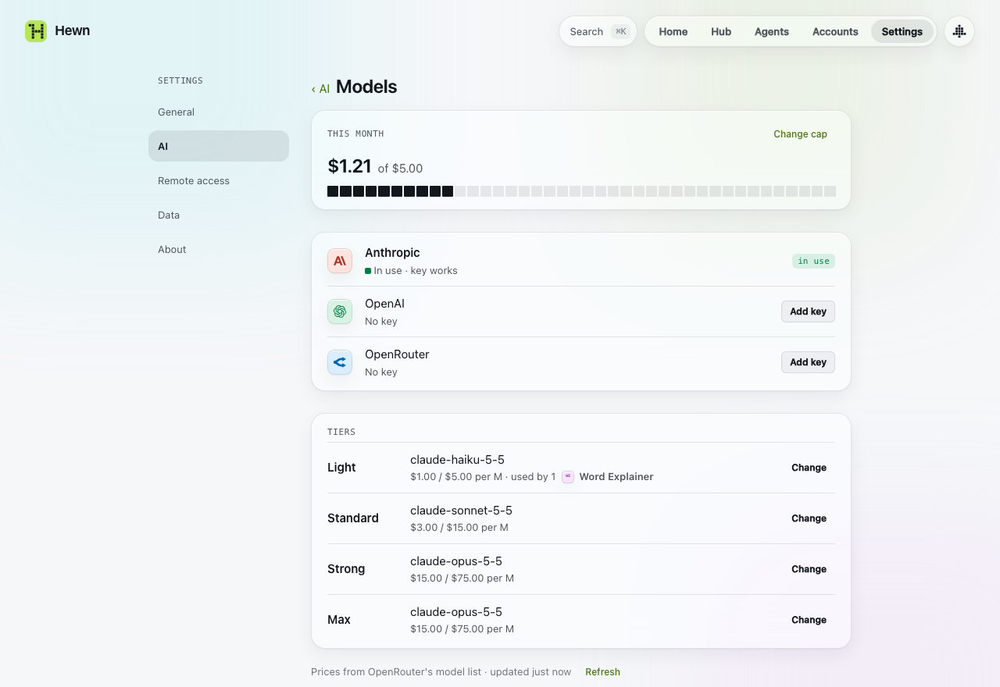

# Models

Some tools think: they suggest tags, explain a word, summarise your week. Those tools call a language model themselves, through Hewn, with **your own API key**. That's separate from your coding agent, which builds your tools ([Hewn's two jobs](concepts.md#hewns-two-jobs)):

| Hewn's job | Who does it | Paid by |
| --- | --- | --- |
| Builds tools (talks it through, then builds) | Claude Code, Codex or OpenCode on your machine | its [sign-in for Hewn](#signing-the-builder-in) (an agent's builds: your API key, when you've set one) |
| Thinks inside tools | a model provider's API | your API key, metered |

Tools call models directly, not through an agent, so your Claude Code, Codex or OpenCode login doesn't cover them, nor does a Claude or ChatGPT subscription. Settings › AI shows both jobs and who does each.

## Signing the builder in

The agent that builds your tools signs in once for Hewn, in a home of its own. In a terminal on the machine that runs Hewn:

```sh
hewn builder sign-in claude      # or codex, or opencode
```

It runs the agent's own sign-in (`claude auth login`, `codex login`, `opencode auth login`) with Hewn's builder home in place of yours. The login is made there by that flow and stays there: Hewn never reads, copies or writes it. Your own Claude Code, Codex or OpenCode stays signed in as it is, and your settings, sessions, MCP servers and skills never reach a build. Every build and every talk with the intake on that agent runs in its builder home, each build in a session of its own.

- **Claude Code** asks once whether you accept Anthropic's [Commercial Terms](https://www.anthropic.com/legal/commercial-terms), which cover running Claude Code in a product such as Hewn; `--yes` accepts. The answer is kept in `platform.json` (`claudeTermsAccepted`).
- **Codex** on a machine without a browser: `hewn builder sign-in codex --device-auth`.
- **OpenCode** is ready once its sign-in has run, with or without a provider: it also runs on its free tier, local models and keys from the environment.

**Settings › AI › Builders on this Mac** shows each one: signed in, not signed in, or not installed. A build or a talk on a builder that isn't signed in stops at once and says so; `hewn doctor` and `hewn builder status` name the command. Coming from 0.4.12, run the sign-in once for the builder you use: until then its builds stop with that message.

An API key in the environment Hewn runs in (`ANTHROPIC_API_KEY`, `OPENAI_API_KEY`) still goes to the builder, as before, and Claude Code and Codex use it over the sign-in.

### Builds nobody is watching

A build an agent asked for (not you, from Hewn or the terminal) may run with nobody at the keyboard. It runs on your API key for the builder's vendor when Settings › AI › Models has one: Anthropic's for Claude Code, OpenAI's for Codex. Without one it runs on the sign-in. The build's log and its line in Activity say which ("on your API key", "on your sign-in (no API key set)"), and the key is billed by the provider. Your own builds use the sign-in, and OpenCode's builds always run on its own sign-in.

Why: the vendors' terms allow your own subscription for your own use through their agents, and an API key is the account they offer for work that runs unattended. Hewn prefers the key and doesn't refuse without one, so your agents' builds keep working.

### The `claude -p` line in `hewn doctor`

Hewn runs Claude Code as `claude -p`. Anthropic has said `--bare`, which never reads the sign-in, will become the default for `-p`. `hewn doctor` reads Claude Code's own help for that change, and a build that fails to sign in while Claude Code says it is signed in says so too. If the line fails, keep the Claude Code version you had until a Hewn release handles it.

## Building tools

Building uses the model you pick for it in Settings › AI (**Builds tools › Model…**), with an effort (low, medium, high, and more on some models). The list comes from the agent itself:

- **Default:** Hewn passes no model; the agent uses its own default, and follows it when that changes.
- **A family** (Claude Code's Fable, Opus, Sonnet, Haiku): the newest of it. Picked on Fable 5.1, the next build after Fable 5.5 ships uses Fable 5.5.
- **A pinned model** (a full name such as `claude-fable-5-1`, any Codex model, whose names carry a version, or an OpenCode `provider/model`): stays on that one. When it's gone, or the agent won't run it, nothing is built: the build (or the chat) stops at once with "… isn't available (why, in the agent's words). Pick another model", and you pick another. The lists mark a model that failed in the last hour, since a list can't tell on its own.

**OpenCode** lists whatever its builder home is signed in to (`hewn builder sign-in opencode`), the providers in your `~/.config/opencode/opencode.json` and its free tier, as `provider/model`; its efforts are the model's own reasoning levels (`--variant`). Its free tier changes which models it serves, and its list can lag behind (a model it has pulled answers "Model is unavailable" for a while): a build on one stops with that reason, the model is marked in the lists for an hour, and Default lets OpenCode choose. A local model server you configured there (Ollama, LM Studio) works for building too: Hewn lets the builder reach that server's port and nothing else on your machine.

Switching agent means choosing its model; Hewn remembers your last choice for each agent. You can also change it in the box where you describe a tool: the model it shows (e.g. **Fable High ⌄**) opens a menu with the current model, an effort slider, and the other models (and a full name). It's the same setting as in Settings › AI, so it stays for what you build next. What you build from a box goes with the model that box shows, even if you picked another in a second tab meanwhile; a tab shows the setting again when you come back to it.

Agents that ask for a build (`capabilities_create`, `capabilities_modify`, `capabilities_add_widgets`) can name a model too, but only one you allow: **Agents may ask for** in Settings › AI (to start with: Default, and Claude Code's families when it builds). Asking for another is an error that names the allowed ones, and an effort the model doesn't take is one that names its levels; nothing is built. Each build says what it ran on, on its page and in Activity.

## Setting it up

The first time a tool asks for a model, its **Allowed to** sheet asks for a provider and a key, and a monthly budget. Pick one of:

- **Anthropic:** Claude models
- **OpenAI:** GPT models
- **OpenRouter:** many vendors with one key

Paste the key; Hewn checks it before saving. Tools never see the key. You can also add keys under Settings › AI › Models.

### Replacing a key

To rotate a key, **Replace…** on the provider's row under Settings › AI › Models opens the same sheet: paste the new key. Hewn checks it first and stores it only if it works; if it doesn't, or can't be checked, the key you had stays. From the terminal, running `hewn models key <provider>` again does the same.

Providers don't tell Hewn when a key expires. If yours has an expiry date, put it in **Expires on** on the same sheet: the row shows it, and the Inbox tells you a week before (by your time zone), and again once it has expired. On the sheet, the date in the field goes with the new key (clear it if the new key doesn't expire), and to change only the date, leave the key empty. From the terminal, `--expires YYYY-MM-DD` gives the new key its date; without it, the new key has none.

## Tiers

A tool asks for a **tier**, not a model, so you can change providers without rebuilding anything:

| Tier | For |
| --- | --- |
| Light | quick, cheap work: tags, short explanations |
| Standard | most work |
| Strong | harder reasoning |
| Max | the most capable |

Settings › AI › Models shows which model each tier uses on your provider, and its price. On a tool's Info, **Allowed to** has its model as a tier menu, with what it spent this month; **A specific model…** at the bottom of that menu pins one model, and the **Monthly cap** row under it sets the tool's own cap.

## Spending

Hewn counts what each call costs from the provider's prices, and stops at your **monthly budget** (default is $5). Calls over the budget are refused, and the tool gets an error it can show. A call the provider doesn't answer in time counts at the most it could have cost, since the provider may still bill it. Settings › AI › Models shows this month's spend and lets you change the budget. A tool can have its own cap too (Info › Allowed to › **Monthly cap**).



The Inbox tells you at 80% of the budget, and when calls were refused.

When a provider retires a model a tool was pinned to, the Inbox says so.

## From the terminal

```
hewn models                          provider, tiers, budget and this month's spend
hewn models key <provider> [--from <path>] [--expires <date>] | --remove
                                     set or replace a key (checked first)
hewn models use <provider>
hewn models tier <tier> <model-id> | --suggested
hewn models cap [<tool>] <usd> | none
hewn models set <tool> <tier> | <provider/model>
                                     what a tool uses
hewn models price <provider/model> <in> <out>
                                     a model's price, USD per M tokens
hewn models list [<provider>]        the provider's models
hewn models check                    test the key
```
