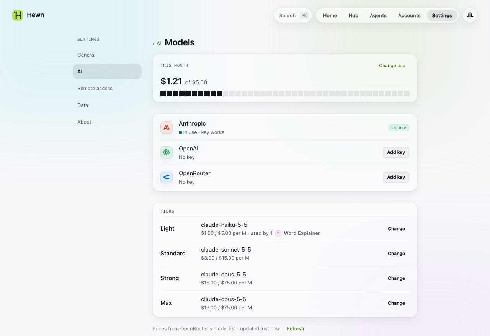

# Models

Some tools think: they suggest tags, explain a word, summarise your week. Those tools call a language model themselves, through Hewn, with **your own API key**. That's separate from your coding agent, which builds your tools ([Hewn's two jobs](concepts.md#hewns-two-jobs)):

| Hewn's job | Who does it | Paid by |
| --- | --- | --- |
| Builds tools (talks it through, then builds) | Claude Code, Codex or OpenCode on your machine | however it's signed in |
| Thinks inside tools | a model provider's API | your API key, metered |

Tools call models directly, not through an agent, so your Claude Code, Codex or OpenCode login doesn't cover them, nor does a Claude or ChatGPT subscription. Settings › AI shows both jobs and who does each.

## Building tools

Building uses the model you pick for it in Settings › AI (**Builds tools › Model…**), with an effort (low, medium, high, and more on some models). The list comes from the agent itself:

- **Default:** Hewn passes no model; the agent uses its own default, and follows it when that changes.
- **A family** (Claude Code's Fable, Opus, Sonnet, Haiku): the newest of it. Picked on Fable 5.1, the next build after Fable 5.5 ships uses Fable 5.5.
- **A pinned model** (a full name such as `claude-fable-5-1`, any Codex model, whose names carry a version, or an OpenCode `provider/model`): stays on that one. When it's gone, or the agent won't run it, nothing is built: the build (or the chat) stops at once with "… isn't available (why, in the agent's words). Pick another model", and you pick another. The lists mark a model that failed in the last hour, since a list can't tell on its own.

**OpenCode** lists whatever it's signed in to (`opencode auth login`), the providers in your `~/.config/opencode/opencode.json` and its free tier, as `provider/model`; its efforts are the model's own reasoning levels (`--variant`). Its free tier changes which models it serves, and its list can lag behind (a model it has pulled answers "Model is unavailable" for a while): a build on one stops with that reason, the model is marked in the lists for an hour, and Default lets OpenCode choose. A local model server you configured there (Ollama, LM Studio) works for building too: Hewn lets the builder reach that server's port and nothing else on your machine.

Switching agent means choosing its model; Hewn remembers your last choice for each agent. You can also change it in the box where you describe a tool: the model it shows (e.g. **Fable High ⌄**) opens a menu with the current model, an effort slider, and the other models (and a full name). It's the same setting as in Settings › AI, so it stays for what you build next.

Agents that ask for a build (`capabilities_create`, `capabilities_modify`, `capabilities_add_widgets`) can name a model too, but only one you allow: **Agents may ask for** in Settings › AI (to start with: Default, and Claude Code's families when it builds). Asking for another is an error that names the allowed ones, and an effort the model doesn't take is one that names its levels; nothing is built. Each build says what it ran on, on its page and in Activity.

## Setting it up

The first time a tool asks for a model, its **Allowed to** sheet asks for a provider and a key, and a monthly budget. Pick one of:

- **Anthropic:** Claude models
- **OpenAI:** GPT models
- **OpenRouter:** many vendors with one key

Paste the key; Hewn checks it before saving. Tools never see the key. You can also add keys under Settings › AI › Models.

## Tiers

A tool asks for a **tier**, not a model, so you can change providers without rebuilding anything:

| Tier | For |
| --- | --- |
| Light | quick, cheap work: tags, short explanations |
| Standard | most work |
| Strong | harder reasoning |
| Max | the most capable |

Settings › AI › Models shows which model each tier uses on your provider, and its price. On a tool's Info, **Allowed to** has its model as a tier menu, with what it spent this month; **Pin a model, set a cap…** at the bottom of that menu sets one model or the tool's own monthly cap.

## Spending

Hewn counts what each call costs from the provider's prices, and stops at your **monthly budget** (default is $5). Calls over the budget are refused, and the tool gets an error it can show. Settings › AI › Models shows this month's spend and lets you change the budget. A tool can have its own cap too (Info › Model).



The Inbox tells you at 80% of the budget, and when calls were refused.

When a provider retires a model a tool was pinned to, the Inbox says so.

## From the terminal

```
hewn models                          provider, tiers, budget and this month's spend
hewn models key <provider> [--from <path> | --remove]
hewn models use <provider>
hewn models tier <tier> <model-id> | --suggested
hewn models cap [<tool>] <usd> | none
hewn models set <tool> <tier> | <provider/model>
                                     what a tool uses
hewn models price <provider/model> <in> <out>
                                     a model's price, USD per M tokens
hewn models list [<provider>]        the provider's models
hewn models check                    test the key
```
