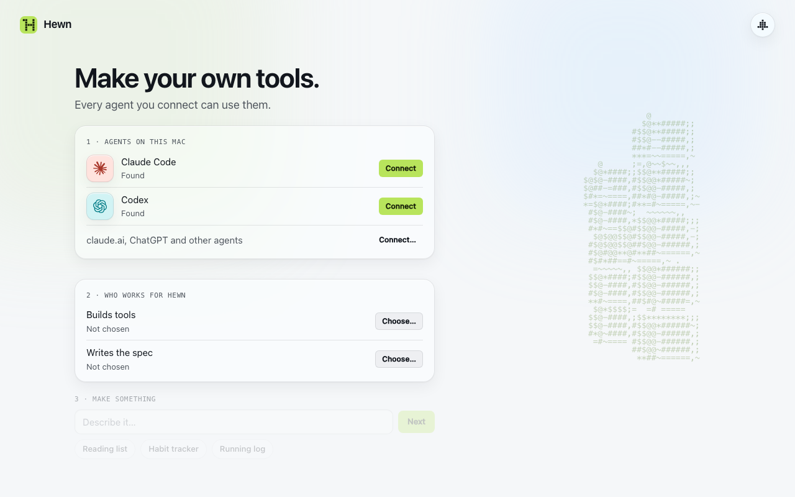

# Quickstart

Hewn runs on your own machine: macOS, Linux, or Windows through WSL.

Install it where your [builder](concepts.md#hewns-three-jobs) (Claude Code or Codex) is signed in, usually the computer you work on. Want Hewn on your phone too? Put it on a machine that's always on and follow [Using Hewn from anywhere](remote-access.md) after this.

## Before you start

- **Node.js 24 or newer.** `node --version`. If it's older: Use [nvm](https://github.com/nvm-sh/nvm), then `nvm install 24`.
- **A builder:** Claude Code (`claude`) or Codex (`codex`), installed and signed in: with a subscription, an API key, or a cloud provider such as Amazon Bedrock or Google Vertex AI. It writes and tests your tools.
- **Linux:** Ubuntu 22.04 or newer, or another distribution with glibc 2.28 or newer.

The install script takes care of the rest on Linux and WSL: it installs bubblewrap (the sandbox) if it's missing, and on WSL tells you how to turn on systemd if it's off.

## Install

```sh
curl -fsSL https://hewn.tools/install.sh | sh
```

It checks Node.js, installs Hewn with npm (`@hewntools/cli`) and puts `hewn` on your PATH. If npm's global folder needs `sudo` (common on Linux), it installs into `~/.local` instead, no `sudo` needed. You can also install directly from npm: `npm install -g @hewntools/cli`.

Installed Hewn before? Remove the old installation first: `hewn uninstall` (see [Uninstall](#uninstall)).

Your data lives in `~/.hewn`, and nightly backups in `~/.hewn-backups`. To keep the data somewhere else, set `HEWN_HOME` before you run `hewn service install` (e.g. `HEWN_HOME=~/Documents/hewn hewn service install`). To put backups somewhere else, e.g. a synced folder: **Settings › Data › Folder** in the web client, or `hewn backup dir <path>`. See [Your data](data.md).

## Start it

```sh
hewn service install    # runs in the background, starts at login, restarts if it stops
hewn doctor             # checks everything: each problem comes with the fix
hewn open               # opens Hewn in your browser, signed in
```

On a healthy install, `hewn doctor` says:

```text
✔ Hewn          running on port 7717
✔ Service       starts at login, restarts on crash
✔ Install       Hewn 0.4.0
✔ workerd       installed
✔ Sandbox       Seatbelt: workerd and builders are confined
✔ Secrets key   in the macOS Keychain
✔ Builder       claude found, logged in
✔ Intake        claude found
✔ Visual check  chrome-headless-shell
✔ Claude Code   Hewn registered (if it asks to sign in: hewn setup --agents claude-code)
✔ Codex         Hewn registered (if it asks to sign in: hewn setup --agents codex)
✔ Backups       last 2026-10-19 · ~/.hewn-backups

No problems.
```

The first run has three steps:
1. Connect the agents on this machine that will use your tools (Claude Code, Codex).
2. Choose who works for Hewn: which agent on this machine [writes the spec](concepts.md#hewns-three-jobs) for a new tool, and which builds it. One agent can do both.
3. Describe your first tool.



## Upgrade

```sh
hewn upgrade
```

It installs the newest release in your minor line (e.g. 0.4.x) with npm, into the same place as before, checks that it starts (and goes back if it doesn't), backs up your data, and restarts Hewn. The new version migrates your data at start. If npm needs `sudo` there, it prints the command to run, then `hewn upgrade --restart-only` does the backup and restart. `hewn version` shows what you're on. A new minor release (e.g. 0.4 → 0.5) is a deliberate move: `hewn upgrade --to 0.5.0`.

## Uninstall

```sh
hewn uninstall          # lists what it would remove
hewn uninstall --yes    # the service, Hewn in Claude Code / Codex, their pointer blocks, the hewn command
```

Your data, backups, Hewn itself (`npm uninstall -g @hewntools/cli`) and the secrets key stay. It prints how to remove each of them.

## Next

- [Concepts](concepts.md): tools, agents, Hewn's three jobs, grants.
- [The web client](using-hewn.md) and [Building tools](building-tools.md).
- [Connecting agents](agents.md): Claude Code, Codex, claude.ai, ChatGPT.
- [Using Hewn from anywhere](remote-access.md): your phone and other computers, on an always-on machine.
- [All the docs](README.md).
