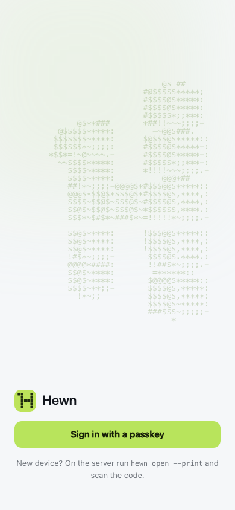

# Using Hewn from anywhere

Hewn runs on your own machine, and that's where it's simplest: `hewn open` on that machine. This guide is for when that machine is always on (a Mac mini at home, a home server, a VPS) and you want access to Hewn from your phone and other computers too. You give Hewn an address you own (the **public URL**) and put HTTPS in front of it. You sign a device in once with a link from the server, and then the device signs itself in with a **passkey**.

It's a self-hosting setup: a domain, DNS and a reverse proxy. For access from anywhere without running a server, [Hewn Cloud](https://hewn.tools/#cloud), the hosted version (coming later), is the easy path.

Without a public URL, the web client is only on the machine Hewn runs on (`hewn open`).

## 0. Hewn and a builder on the server

What the server needs:

- **Linux:** Ubuntu 22.04 or newer (24.04 is what Hewn is tested on), or another distribution with glibc 2.28 or newer. Older ones can't run Node 24 or Claude Code (`GLIBC_2.28' not found`).
- **2 GB of memory or more**, 20 GB of disk.
- **A VM on Proxmox (or another hypervisor):** set the CPU type to `host` (or `x86-64-v3`), then stop and start the VM. The default type (`kvm64`, `x86-64-v2-AES`) hides CPU features such as AVX2 that some tools' binaries need.

Install Hewn on the server with the [quickstart](quickstart.md) (`hewn service install` keeps it running after you log out and across reboots).

The agent that [builds your tools](concepts.md#hewns-two-jobs) runs Claude Code or Codex **on the machine Hewn runs on**, so the server needs one of them installed and signed in (a subscription, an API key, or a cloud provider), as the same user that runs Hewn. Over SSH:

```sh
npm install -g @anthropic-ai/claude-code && claude   # follow the sign-in link on any device
# or
npm install -g @openai/codex && codex login --device-auth
```

`hewn doctor` checks it.

## 1. Set the public URL

On the server:

```sh
hewn url https://hewn.example.com
```

It must be `https://` and a domain name (passkeys can't be made for an IP address). Everything is on that one name: the web client, sign-in, MCP, and tool apps under `https://hewn.example.com/tools/<id>/`.

`hewn url` prints everything below for your address. Run it again at any time to see it.

## 2. DNS

One record at your DNS provider, pointing at the address the internet reaches your reverse proxy on:

```
hewn.example.com    A    <your public IP>
```

## 3. HTTPS in front of Hewn

Your reverse proxy serves `hewn.example.com` over HTTPS and forwards to Hewn's **public listener**, `127.0.0.1:7718` (the local port + 1, or `HEWN_PUBLIC_PORT`), keeping the `Host` header. On the public URL it serves the web client, tool apps, passkey sign-in, MCP and OAuth. Admin never answers there, and requests are rate limited per address.

### Caddy

```
hewn.example.com {
	reverse_proxy 127.0.0.1:7718
}
```

Caddy gets the certificate itself. If it already serves other sites, add this block next to theirs and run `caddy reload`.

### Caddy (or any proxy) on another machine

Let the public listener answer on the network too:

```sh
hewn url --listen 192.168.1.50     # this machine's LAN address
hewn service restart
```

In a container, or to answer on every interface, use `hewn url --listen 0.0.0.0`.

Then point the proxy at `192.168.1.50:7718`. Only the public listener goes on the network; the web client's local port and admin stay on `127.0.0.1`. To allow only the proxy: `sudo ufw allow from <proxy's address> to any port 7718 proto tcp` (with the firewall on). `hewn url --listen off` goes back to this machine only.

### Only through your proxy (`HEWN_PROXY_SECRET`)

If the public listener can be reached without going through your proxy (a host with its own public address), set `HEWN_PROXY_SECRET` in `hewn serve`'s environment and have the proxy send it on every request as the `x-hewn-proxy-secret` header. Requests without it, or with another value, get 403; the header is removed before anything else sees it, and `X-Forwarded-Host` / `X-Forwarded-For` only count on requests that had it. A tunnel (`hewn tunnel`) doesn't send the header, so don't combine the two. The local port is not affected. Unset (the default): no check.

### Running Hewn for someone else (`HEWN_HOSTED`)

If you run Hewn for its owner and they have no terminal on the machine (a hosting service), set `HEWN_HOSTED=1` in `hewn serve`'s environment, together with `HEWN_BUILD_URL` (your builder: there are no agents on the machine to build with). `HEWN_HOST_SIGNIN_URL`, an https link where you sign the owner in and send them back with a sign-in link, is optional. Hewn sends your builder's service each build as `POST /v1/builds` ([the request](internal/remote-builder.md)); a retry says which build it retries (`retryOf`, the first of the chain), so you can count the chain as one build.

Then the web client and its pages never send the owner to a command: signed out, they get a **Sign in** button to `HEWN_HOST_SIGNIN_URL` (or passkey sign-in, once they've added one); an agent's sign-in page links to Hewn to approve it; the first run has no "who builds" step; and Settings hides what you manage (the address, the sandbox, the backup folder, upgrades, and which agent builds). Connecting agents is through the public address only. Tools that think (`ctx.model`) run on your models, through your builder's service (`/v1/generate`), so the owner needs no API key; Settings › AI › Models shows what each tier runs on and what you charged this month. Unset (the default): nothing changes.

#### Suspending Hewn when idle

If you run Hewn on a machine you can suspend and wake (a VM that sleeps when unused), Hewn tells you when it's safe to: `GET /status` on the [metrics port](#metrics-hewn_metrics_port) answers with JSON, and `hewn status --json` gives the same under `idle`. Hewn never suspends itself and sends nothing; you read it, and you decide.

```json
{ "idle": false, "since": null, "busy": ["build"], "nextAlarmAt": "2026-11-10T05:00:00.000Z",
  "backup": { "lastAt": "2026-11-09T03:12:44.000Z", "changedSince": true },
  "lastRequestAt": "2026-11-09T14:02:10.000Z", "lastCallAt": "2026-11-09T14:02:11.000Z" }
```

- **`idle`** is true when every reason is clear. **`busy`** names each one that isn't: `starting` (Hewn started or woke less than 10 minutes ago, whatever quiet time you ask for, so a Hewn you just woke isn't put back to sleep at once), `request` (you or an agent used Hewn in the last 10 minutes), `call` (a tool call, a schedule's run too), `build` (one queued or running; one paused for the owner isn't), `intake` (a reply on its way), `stream` (an open stream that wrote in the last 10 minutes), `backup` (something changed since the newest backup and none was made today) and `alarm-soon` (a schedule due within 2 minutes).
- **`since`** is when the last activity ended (a request, a call, a stream's last write, a build or reply finishing, the start or a wake), so you can apply your own idle time; or ask with `?after=<seconds>` instead of the 10 minutes. It's null while a reason that isn't a clock holds (`build`, `intake`, `backup`, `alarm-soon`).
- **`nextAlarmAt`** is when the next schedule runs, or null: wake Hewn before it. The daily backup isn't an alarm: **`backup`** says when the newest backup was made (any backup: the nightly one or `hewn backup now`) and whether anything changed since, and you choose whether to wake Hewn for one.
- Your own traffic doesn't count: reading `/status` or `/metrics`, the `hewn` commands' own calls to Hewn (`hewn backup now`, `hewn status`), and Hewn's health checks. A page's own refreshes don't either (an open Home refreshing its widgets), and a hidden browser tab makes no requests at all. A request Hewn refuses, or one anyone may make (the files the sign-in page loads, the OAuth endpoints, `robots.txt`), doesn't count: a scanner on your public address doesn't keep Hewn awake. A [share link](sharing.md#links)'s download does: someone was given the link.
- A request to a suspended Hewn wakes it if your platform starts the machine on traffic. After a wake, Hewn catches up by itself: when its clock jumps ahead it runs every schedule that came due while it slept (once, however many times it was missed), and makes the day's backup if it's due; once more 15 seconds later, while the clock settles.
- `hewn status` shows the same in a line: `Idle since 14:02 · next alarm 06:00`.

### Metrics (`HEWN_METRICS_PORT`)

Set `HEWN_METRICS_PORT` in `hewn serve`'s environment to serve Prometheus text at `GET /metrics` on that port, for whoever runs Hewn to scrape. It listens on all interfaces, so let only your scraper reach it. Off unless set, and pulled only: Hewn sends it nowhere. It has counts and sums, never what's in your tools, and its labels are fixed categories: no tool, widget or agent is ever named, so what you called your tools stays with you, also in whatever stores the scraped series:

- `hewn_info` (the version), `hewn_tools` by state, `hewn_builds` by status, and the time of builds promoted in the last 7 days.
- `hewn_calls`: tool calls in the last 24 hours and 7 days, by the kind of caller that called them directly (`caller`): `user` (you), `agent` (any connected agent), `ui` (a tool's own page), `widget`, `schedule`, or `capability` (another tool); and how they went (`outcome`: `ok` or `error`).
- `hewn_tools_used`: how many different tools were called in the last 24 hours, by the same kinds of caller. A tool called many times counts once; never which tools.
- Model spend, tokens and calls this month; connected agents (and those active in the last 7 days); schedules by status, and those failing.
- The idle report ([below](#suspending-hewn-when-idle)): `hewn_idle` (1 when idle), `hewn_busy` (1 for each reason it isn't, by `reason`), `hewn_next_alarm_seconds` (when the next schedule runs, in epoch seconds; 0 if none) and `hewn_backup_changed_since` (1 when something changed since the newest backup).

`/status` on the same port is the one place with times rather than counts: when Hewn was last used (`lastRequestAt`, `lastCallAt`) and when its next schedule runs. Still no names, but keep the port private.

Calls come from the call logs, so they reach back only as far as those are kept ([Call logs](data.md#call-logs)). A build or schedule status Hewn doesn't know shows as `other`. For calls per tool or per agent, look in [Activity](using-hewn.md#activity), which filters by both.

### Other reverse proxies

Anything that serves `hewn.example.com` over HTTPS and forwards to the public listener with the original `Host` works (nginx: `proxy_set_header Host $host;`, and turn off buffering for `text/event-stream`).

### A named cloudflared tunnel

For a server you can't open ports on, and no reverse proxy: `hewn tunnel start --cloudflared <tunnel> --hostname hewn.example.com`, then `hewn url https://hewn.example.com`. The tunnel's DNS record replaces the one in step 2.

Quick tunnels (`--quick`) and Tailscale Funnel stay MCP-only: a quick tunnel changes address on every start.

## 4. Sign in, then add a passkey

On the server, over SSH:

```sh
hewn open --print
```

It prints a one-time link on the public URL and a QR code. Scan it with your phone (or open the link on your laptop). The link works once, for two minutes. You're signed in, and Hewn offers to **add a passkey** on the device: Face ID, a fingerprint or the screen lock. From then on, open `https://hewn.example.com` and tap **Sign in with a passkey**.



Passkeys sync through iCloud Keychain or Google Password Manager, so a passkey added on your phone often works on your other devices too. Settings › **Remote access** lists your passkeys (remove one there) and the browsers that are signed in.

New device, or lost the passkey? `hewn open --print` again.

## What the public address exposes

On the public URL itself: the web client, tool apps, passkey sign-in, MCP and the OAuth sign-in agents use. On any other name that reaches the public listener (a tunnel's, say), only MCP, OAuth, share links and `robots.txt`. Admin never answers there. Everything is rate limited per address, and logged.

**Share links** (`/share/<code>`, [Sharing tools](sharing.md#links)) are the one thing there that needs no sign-in: each serves one version of one tool as a file, to whoever has the link, until it expires or you revoke it. Nothing else answers under `/share/`: a code that isn't a working link gets the same 404 as one that never existed. The code is 192 random bits and never written to Hewn's log (it shows as `/share/…`), and links are rate limited per address and per link. Every answer under `/share/` carries `X-Robots-Tag: noindex, nofollow`, and `robots.txt` disallows `/share/`, so search engines keep out.

## How it's protected

- **Only a shell on the server can let a device in without a passkey.** The sign-in page offers passkeys and nothing else: no passwords, no "email me a link". A passkey is added only from a signed-in session.
- **Passkeys are bound to the address.** A passkey made for `hewn.example.com` can't be used anywhere else, which makes phishing pages useless. It also means that changing the public URL means adding passkeys again (`hewn url` tells you how many no longer work).
- **Tool apps are sandboxed.** Each app page gets an origin of its own from the browser (an opaque one): it can't read the web client, your session, its cookies or storage, or another app. It reaches only its own tool's operations, with a token of its own.
- **Cookies** on the public URL are `__Host-`, `Secure`, `HttpOnly`, `SameSite=Strict`, and the web client refuses requests from any other origin, tool apps included.
- **Tool names stay private.** The certificate (and the public Certificate Transparency logs) name only `hewn.example.com`; app paths aren't in DNS or certificates.
- Hewn requires user verification for every passkey (the device checks it's you) and refuses an authenticator whose signature counter goes backwards.

See also [the threat model](threat-model.md).
