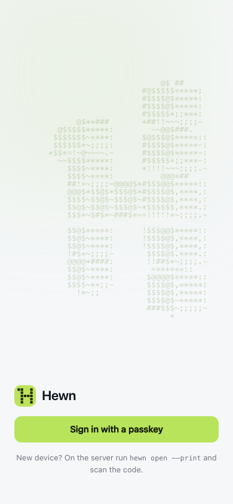

# Using Hewn from anywhere

Hewn runs on your own machine, and that's where it's simplest: `hewn open` on that machine. This guide is for when that machine is always on (a Mac mini at home, a home server, a VPS) and you want access to Hewn from your phone and other computers too. You give Hewn an address you own (the **public URL**) and put HTTPS in front of it. You sign a device in once with a link from the server, and then the device signs itself in with a **passkey**.

It's a self-hosting setup: a domain, DNS and a reverse proxy. For access from anywhere without running a server, [Hewn Cloud](https://hewn.tools/#cloud), the hosted version (coming later), is the easy path.

Without a public URL, the web client is only on the machine Hewn runs on (`hewn open`).

## 0. Hewn and a builder on the server

What the server needs:

- **Linux:** Ubuntu 22.04 or newer (24.04 is what Hewn is tested on), or another distribution with glibc 2.28 or newer. Older ones can't run Node 24 or Claude Code (`GLIBC_2.28' not found`).
- **2 GB of memory or more**, 20 GB of disk.
- **A VM on Proxmox (or another hypervisor):** set the CPU type to `host` (or `x86-64-v3`), then stop and start the VM. The default type (`kvm64`, `x86-64-v2-AES`) hides CPU features such as AVX2 that some tools' binaries need.

Install Hewn on the server with the [quickstart](quickstart.md) (`hewn service install` keeps it running after you log out and across reboots).

The [builder and the intake](concepts.md#hewns-three-jobs) run Claude Code or Codex **on the machine Hewn runs on**, so the server needs one of them installed and signed in (a subscription, an API key, or a cloud provider), as the same user that runs Hewn. Over SSH:

```sh
npm install -g @anthropic-ai/claude-code && claude   # follow the sign-in link on any device
# or
npm install -g @openai/codex && codex login --device-auth
```

`hewn doctor` checks it.

## 1. Set the public URL

On the server:

```sh
hewn url https://hewn.example.com
```

It must be `https://` and a domain name (passkeys can't be made for an IP address). Everything is on that one name: the web client, sign-in, MCP, and tool apps under `https://hewn.example.com/tools/<id>/`.

`hewn url` prints everything below for your address. Run it again at any time to see it.

## 2. DNS

One record at your DNS provider, pointing at the address the internet reaches your reverse proxy on:

```
hewn.example.com    A    <your public IP>
```

## 3. HTTPS in front of Hewn

Your reverse proxy serves `hewn.example.com` over HTTPS and forwards to Hewn's **public listener**, `127.0.0.1:7718` (the local port + 1, or `HEWN_PUBLIC_PORT`), keeping the `Host` header. On the public URL it serves the web client, tool apps, passkey sign-in, MCP and OAuth. Admin never answers there, and requests are rate limited per address.

### Caddy

```
hewn.example.com {
	reverse_proxy 127.0.0.1:7718
}
```

Caddy gets the certificate itself. If it already serves other sites, add this block next to theirs and run `caddy reload`.

### Caddy (or any proxy) on another machine

Let the public listener answer on the network too:

```sh
hewn url --listen 192.168.1.50     # this machine's LAN address
hewn service restart
```

Then point the proxy at `192.168.1.50:7718`. Only the public listener goes on the network; the web client's local port and admin stay on `127.0.0.1`. To allow only the proxy: `sudo ufw allow from <proxy's address> to any port 7718 proto tcp` (with the firewall on). `hewn url --listen off` goes back to this machine only.

### Only through your proxy (`HEWN_PROXY_SECRET`)

If the public listener can be reached without going through your proxy (a host with its own public address), set `HEWN_PROXY_SECRET` in `hewn serve`'s environment and have the proxy send it on every request as the `x-hewn-proxy-secret` header. Requests without it, or with another value, get 403; the header is removed before anything else sees it, and `X-Forwarded-Host` / `X-Forwarded-For` only count on requests that had it. A tunnel (`hewn tunnel`) doesn't send the header, so don't combine the two. The local port is not affected. Unset (the default): no check.

### Other reverse proxies

Anything that serves `hewn.example.com` over HTTPS and forwards to the public listener with the original `Host` works (nginx: `proxy_set_header Host $host;`, and turn off buffering for `text/event-stream`).

### A named cloudflared tunnel

For a server you can't open ports on, and no reverse proxy: `hewn tunnel start --cloudflared <tunnel> --hostname hewn.example.com`, then `hewn url https://hewn.example.com`. The tunnel's DNS record replaces the one in step 2.

Quick tunnels (`--quick`) and Tailscale Funnel stay MCP-only: a quick tunnel changes address on every start.

## 4. Sign in, then add a passkey

On the server, over SSH:

```sh
hewn open --print
```

It prints a one-time link on the public URL and a QR code. Scan it with your phone (or open the link on your laptop). The link works once, for two minutes. You're signed in, and Hewn offers to **add a passkey** on the device: Face ID, a fingerprint or the screen lock. From then on, open `https://hewn.example.com` and tap **Sign in with a passkey**.



Passkeys sync through iCloud Keychain or Google Password Manager, so a passkey added on your phone often works on your other devices too. Settings › **Remote access** lists your passkeys (remove one there) and the browsers that are signed in.

New device, or lost the passkey? `hewn open --print` again.

## How it's protected

- **Only a shell on the server can let a device in without a passkey.** The sign-in page offers passkeys and nothing else: no passwords, no "email me a link". A passkey is added only from a signed-in session.
- **Passkeys are bound to the address.** A passkey made for `hewn.example.com` can't be used anywhere else, which makes phishing pages useless. It also means that changing the public URL means adding passkeys again (`hewn url` tells you how many no longer work).
- **Tool apps are sandboxed.** Each app page gets an origin of its own from the browser (an opaque one): it can't read the web client, your session, its cookies or storage, or another app. It reaches only its own tool's operations, with a token of its own.
- **Cookies** on the public URL are `__Host-`, `Secure`, `HttpOnly`, `SameSite=Strict`, and the web client refuses requests from any other origin, tool apps included.
- **Tool names stay private.** The certificate (and the public Certificate Transparency logs) name only `hewn.example.com`; app paths aren't in DNS or certificates.
- Hewn requires user verification for every passkey (the device checks it's you) and refuses an authenticator whose signature counter goes backwards.

See also [the threat model](threat-model.md).
