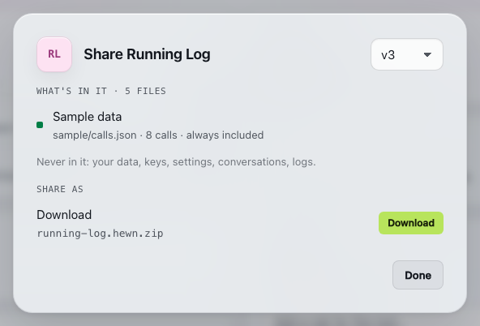
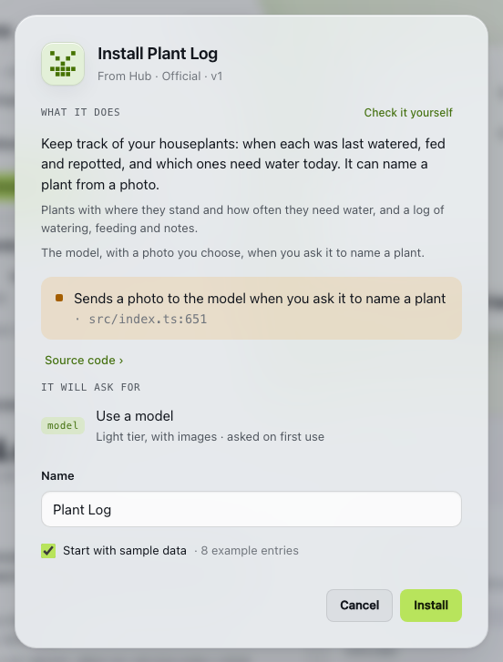

# Sharing tools

A tool you made can travel as a file: you share it, someone installs it in their own Hewn, and it runs there as theirs. What travels is the code and its sample data, never your data.

## What travels and what never does

A shared tool is one file, `<tool>.hewn.zip`, with one version's files as they are: its manifest (`capability.json`), code (`src/`), tests, database migrations, screens (`ui/`) and **sample data** (`sample/calls.json`). Hewn adds one small file that says which tool and version it is.

**Hewn never puts in it** your data, keys, settings, conversations with the builder, logs, or anything that says whose Hewn it came from. The code is what your builder wrote, though, and a value can end up in it (a key pasted into a request, an address in a test), so Share… checks it first.

## Sharing a tool

**Share…** on a tool (in the top bar of Info and of the open tool, or the tool's menu) shows what the file would hold before you download it:

- **What's in it:** anything in the files that looks personal (an email address, a phone number, coordinates) or like a key (`sk-…`, a GitHub or AWS token, a long random string), and any of your own settings (a value you gave one of your tools, such as a city or a site), each with the file and line, partly hidden; **Show** reveals it. These are warnings: test data often trips them, and a setting may well be something anyone could write, so read them and decide.
- **Sample data:** how many calls it holds. Sharing needs it (below).
- **Download:** the file. Pick any version, not only the live one.

Two things stop a share:

- **One of your own keys is in the code:** a key you gave any of your tools, or a model provider's key. Share… lists each by file and line, and **Change…** asks the builder to take them all out. Share again once the new version is live.
- **No sample data.** **Ask builder** adds it (the usual way: it writes made-up entries that fit the tool), or **Write it yourself**. A connection shares without it: it has no data of its own to show, and its sign-in never travels (whoever installs it signs in with their own account).

From the terminal: `hewn share <id> [--version N] [--out file]` prints the same findings and writes the file unless something stops it.

## Sample data

Sample data is what a tool looks like in use: a list of calls to its operations (`sample/calls.json`) that fill an empty tool with made-up entries. Whoever installs your tool can start with it instead of a blank screen, and screenshots of the tool use it. It holds made-up names and places, never yours.

Builders write sample data when they create a tool, and keep it working when a change reshapes the operations. For a tool from before that, **Ask builder** in Share… adds some. **Write it yourself** opens `sample/calls.json` in an editor, with the format and what each operation takes beside it (**+ Add** puts in a call with its required fields): saving makes a new version, which goes live only if every call runs without an error on an empty tool. The calls run before the tool is allowed anything, so they're plain writes: no network, no other tools, no model. The format is in [the tool spec](../spec/tools.md#sample-data-since-25).

## Installing a tool someone shared

**Install from a file** (Settings › Data, or search for it with `⌘K`) takes a `.hewn.zip`, up to 5 MB.

First, the agent that builds your tools reads its code and says what it does with your data, usually in under a minute: **What it does** (with what it keeps, and where your data goes), and **What it found**: warnings you should know about before installing (it says one thing and does another, it asks for something it never uses, data leaves for a host or the model without the description saying so), each with **Show** to see the code at that line, and what checks out. It's advice: the code is what runs, and **Source code ›** has all of it. **Install anyway** stops the reading and goes on without it; **Cancel** stops it and installs nothing. The reader gets the tool's code and nothing else: no tools, no web, and text in the code that tries to steer it is one of its warnings. With no builder set up, there's no reading; the code is still there to read. On a hosted Hewn, the reading uses Credits, as a turn with the intake does.

Then one sheet shows:

- **What it does**, its warnings, and **Source code ›**: every file, as it is, before you install it.
- **It will ask for:** the hosts it reaches, a model, other tools, keys or settings. This is a preview: nothing is granted by installing. The tool asks once it's installed, as any new tool does.
- **Name:** its own, or "Plant Log 2" if you already have a Plant Log. The tool's id comes from the name.
- **Start with sample data**, ticked when it has some.

Installing runs the tool's own tests, as for any build, but no builder: the code is the file's. Then the tool opens and asks for what it needs.

Info shows where it came from ("from a file · Plant Log v7"), and Activity and the build say "Installed from a file". Change it like any of your tools: it's yours now, and nothing pulls updates from where it came from.

A file is refused with the reason when it isn't a tool Hewn shared, it's over 5 MB or holds more than 1,000 files, it names one file twice (`src/index.ts` and `SRC/index.ts` are one file on many disks), its npm dependencies aren't all registry versions or it carries npm settings (`.npmrc`), or it needs a newer Hewn (a newer file format or tool spec: then `hewn upgrade` and try again). Code that imports anything outside the tool fails to install, saying which import.

From the terminal: `hewn install <file.hewn.zip> [--name "Plant Log 2"] [--no-sample]`.

A file can't bring a reading of its own: whatever it says about itself is ignored, and your builder reads it.

## The Hub

The **Hub** tab holds tools ready to install. In this release it's Hewn's own (**Official**): Habits, Plant Log, Gift Ideas, Kid Quotes, Idea Tracker, Reading List and Running Log, shipped with Hewn (`seeds/` in the repo). A tool's page shows what it does and what it keeps (Hewn's reading of its code), its operations and its **Source code**; there's no file to download. **Install** opens the same sheet as for a file, with Hewn's reading already in it, so there's no wait; **Check it yourself** has your builder read it too. Info shows "from Hub · Official", and Activity "Installed from Hub". They're yours once installed, like any tool. Tools from other people come to the same Hub later.

## Start over

Info › Data › **Start over** empties a tool's data and keeps the tool: after trying it with sample data, or any time you want it empty. You type the tool's id to confirm, and can tick **And replay the sample data** (when it has some). A copy of its data is kept aside first (the newest three). From the terminal: `hewn data reset <id> [--sample]`.

## Is it safe to install a tool from someone else?

It runs in the same sandbox as tools your builder makes, through the same checks: its manifest, its tests, its migrations. Its code can use only its own files and npm packages from the npm registry: a file whose dependencies point anywhere else (a path on your disk, git, a URL) or that carries npm settings is refused, and an import from outside the tool fails the install. Nothing in the file can grant itself anything: what it reaches (hosts, a model, your other tools) is asked of you after it's installed, one grant at a time, as for any tool. A shared connection never brings anyone's sign-in: you sign in with your own account. Your builder's reading is advice, not a guarantee: read **Source code** first if you're unsure what it does with your data. See the [threat model](threat-model.md).
