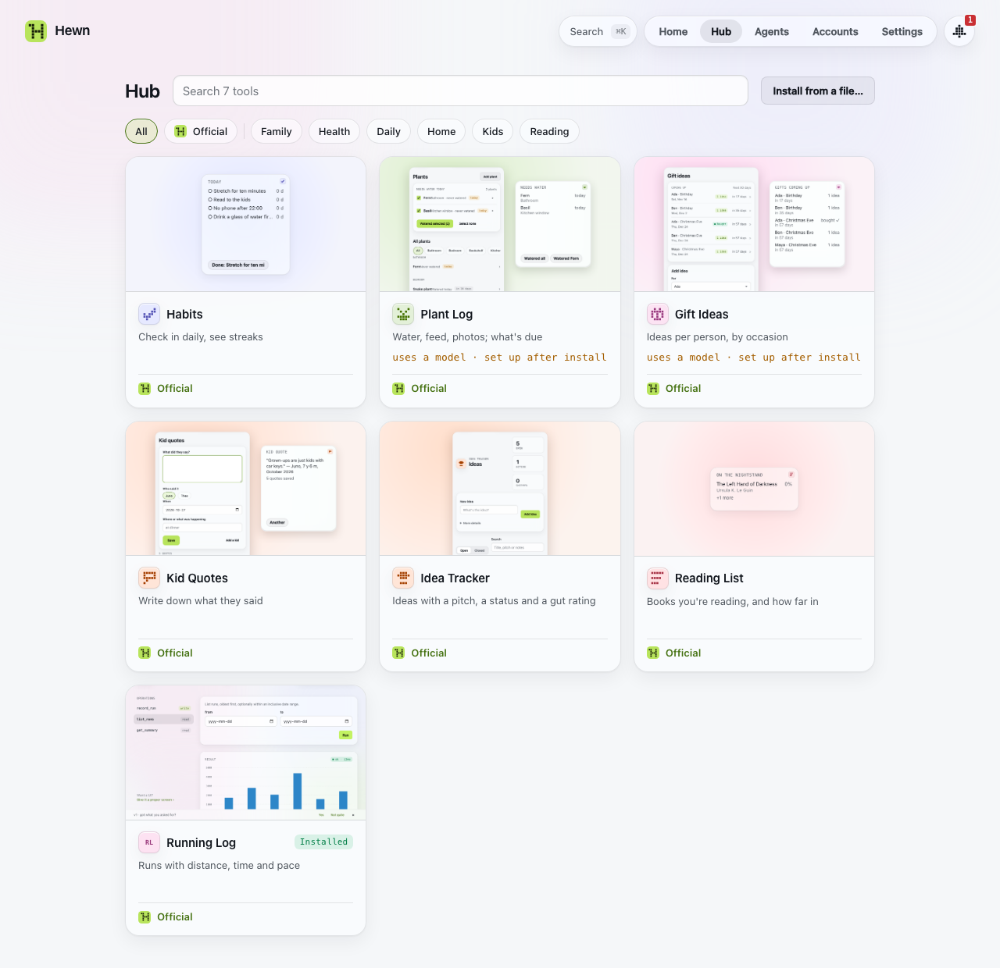

# The web client

`hewn open` opens Hewn in your browser, signed in. Hewn's web client runs only on the machine Hewn runs on, unless you've set up [a public URL](remote-access.md).

The top bar has Search, **Home · Hub · Agents · Accounts · Settings**, and the **Inbox** on the right.

## Home

Home holds your tools as icons, and the widgets you've put there. Click a tool to open it: its own screen if it has one, otherwise its operations as forms. The **New** tile asks for a new tool ([Building tools](building-tools.md)).

Right-click a tool for its menu:
- **Open**, **Change…** and **Info**
- **Widgets…**, **Activity** and **Versions**
- **Rename**, **Set icon…** (draw a 5×5 glyph and pick its colour and saturation, or upload an image; saturation 0 draws it black or white on grey, for a black-and-white brand), **Share…** (the tool as a file: [Sharing tools](sharing.md)) and **Export data**
- **Delete…**

Right-click a widget for **Open**, **Refresh**, **Options…** (for a widget that takes options, such as which item to show: the same form as when you added it, with a preview), **Change…** and **Remove widget**.

**Edit Home:** right-click empty space and choose Edit Home, or press `e`. Drag tiles to move them. Tap a widget's size tag (S, M or L) to switch to its next size, or × to remove it. × on a tool hides it from Home: it's still in search, and **Show on Home** in its menu brings it back. **+ Add widget** shows every widget your tools offer, with a preview. **Done** (or Esc) saves.

A widget shows a tool's data at a glance: today's habits, tonight's aurora forecast, a quote. It refreshes by itself. When it couldn't refresh, it keeps the last view and says how old it is.

## The Hub

**Hub** holds tools ready to install: today Hewn's own (**Official**), which come with Hewn, so the Hub works offline. Search, or pick a tag; each card shows what the tool is for and what it needs ("reaches api.met.no", "uses a model"; nothing when it needs nothing), and **Installed** when you have it. A tool's page has its screens (click one to see it larger), what it does and keeps (Hewn's reading of its code), its operations, what it needs, its versions and its **Source code** (a version opens it too). **Install** opens the install sheet ([Sharing tools](sharing.md#installing-a-tool-someone-shared)); a tool you have already, under any name, offers **Open** and **Install a copy**. **Install from a file…** is here too.

New also offers it under the box: **Or start from** a tool in Hub, or a file someone shared ([Sharing tools](sharing.md#installing-a-tool-someone-shared)).

## Search and commands

Press `⌘K` (or `Ctrl K`, or `/`), or click Search. Type to find a tool, a page (Activity, Models, Backups…) or an action (New tool, Edit Home, Back up now, Install from a file…). Enter opens it. Tools on the Hub you don't have yet come last.

## The Inbox

The **Inbox** button on the right of the top bar holds everything that needs you, with a count:
- tools waiting for your approval of what they need (a host, a key, another tool, a model)
- agents waiting to be approved
- schedules an agent proposed
- builds that failed
- connections that need you to sign in again
- model spend at 80% of your budget, or calls refused over it

Each row has one action. **Activity** in the Inbox shows what just happened, and builds in progress pulse.

One thing doesn't wait in the Inbox: when an agent calls an operation marked *destructive* (deleting runs, say), the agent is stuck until you answer. A banner shows on every page until you allow it once or stop it.

## A tool's page

**Info** (in the tool's menu) is one page about the tool: what it's for, its status, and each part of it as a section you act on right there:
- **Operations:** each with **Run**, which opens it as a form and shows the result; the first five, then **Show all**
- **Allowed to:** the hosts, keys, other tools and model it may use. **Authorize** or **Deny** a host, another tool or the model it asks for (a no is kept until its next version, and through a quick change such as another tier; it can't run without it, so Info offers **Ask builder to work without it**), **Set…** a key it asks for, **Revoke** what it has. The model's row has its tier (or **A specific model…**) in a menu, what it spent this month, and its own monthly cap ([Models](models.md))
- **Data:** how many rows it keeps, when it last wrote, **Export**, and **Start over** (empty it, keep the tool: [Sharing tools](sharing.md#start-over))
- **Schedules:** a switch each, **+ Add schedule**, and **Try again** on a failed run (one run now, as the schedule runs; if it works, one paused after failing stays paused until you switch it on)
- **Widgets:** the widgets themselves, at the size they have on Home (else their largest; **S M L** shows the others), and **Add to Home**
- **Instructions:** standing rules for this tool's builds, removed or added in place ([Building tools](building-tools.md#instructions))
- **Versions:** the last two, and **All versions**; a version's **Details** has its conversation, spec, log and code ([Building tools](building-tools.md#versions))

Anything that needs you (something to authorize, a failed change, a model to set up, a paused schedule) sits at the top with its one button. Every section shows, with a way to add one when it's empty. In a wide window the sections sit in two columns.

The **Change it** box asks for a change ([Building tools](building-tools.md#changing-a-tool)).

**When something in a tool fails** (an operation in its own screen, a run from Info, a widget that can't refresh, a schedule's run), Hewn offers **Ask builder to fix this**. It opens a change to the tool with what failed in the box (the operation, the error, its input and the last log lines) and "Fix it so this works." Add anything you know, and send it. Hewn keeps a tool's last ten failed calls for this.

### Schedules

A schedule runs a read or write operation hourly, daily, weekly or on a custom cadence, in your time zone (Settings › General). Info › Schedules lists them, with a switch each and when they run next. **+ Add schedule** adds one.

Agents can propose a schedule, but nothing runs until you enable it from the Inbox. A schedule that fails three times in a row pauses itself and says why. Resume it when it's fixed.

## Activity

Everything that happened, newest first: builds, calls, and access changes (agents approved or disconnected, grants, secrets, destructive calls). Filter by kind (All, Builds, Calls, Access), by tool or by agent. Press `a` to open it.

Builds show their milestones (spec, code, tests) as they happen. Open one to see its log. A failed build keeps its log open under the reason.

Call logs are kept for two weeks by default (Settings › Data).

## Agents and Accounts

- **Agents** lists the agents that use your tools, and the ones that work for Hewn. See [Connecting agents](agents.md).
- **Accounts** lists your connections to other services, and their health. See [Connections](connections.md).

## Settings

- **General:** appearance (system, light or dark), your time zone, and whether the sandbox is on.
- **AI:** who does [Hewn's two jobs](concepts.md#hewns-two-jobs) (builds tools, on which model, and thinks inside tools), which models agents may ask for, your [instructions for building](building-tools.md#instructions), and the Models page ([Models](models.md)).
- **Remote access:** the public URL, your passkeys and signed-in browsers ([Using Hewn from anywhere](remote-access.md)).
- **Data:** backups and their folder, how long call logs are kept, and deleted tools ([Your data](data.md)).
- **About:** the version, whether a newer one is out (with the command to upgrade), and shortcuts.

## On a phone

On a narrow screen, Home is a four-column grid, the menu folds into ☰ (the Inbox stays), and tools open full screen. The other pages work on a phone, but are laid out for a computer. To reach Hewn from your phone at all, see [Using Hewn from anywhere](remote-access.md).

## Shortcuts

| Key | |
| --- | --- |
| `n` | New tool |
| `h` | Home |
| `e` | Edit Home |
| `i` | Inbox |
| `a` | Activity |
| `b` | Builds |
| `g` | Agents |
| `u` | Accounts |
| `,` | Settings |
| `/` or `⌘K` | Search and commands |
| `?` | Shortcuts |
| `Esc` | Close a dialog, a menu or the Inbox |
