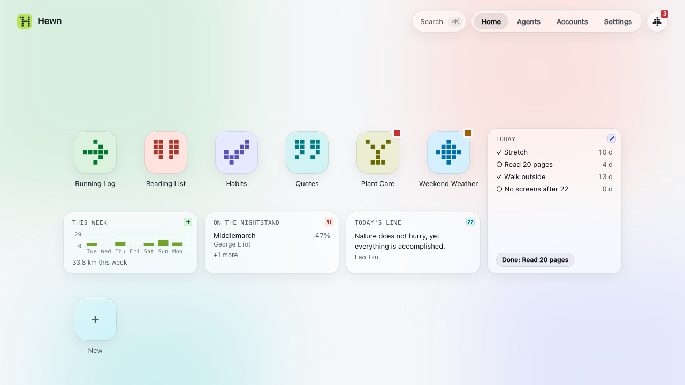
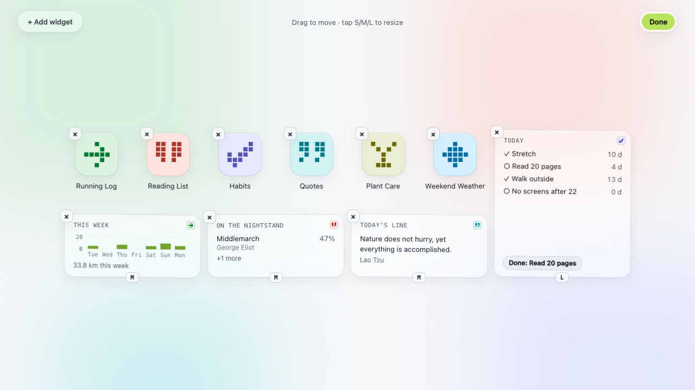
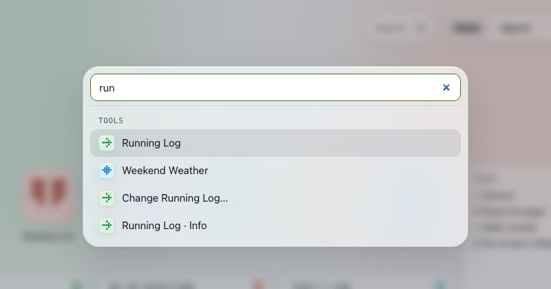
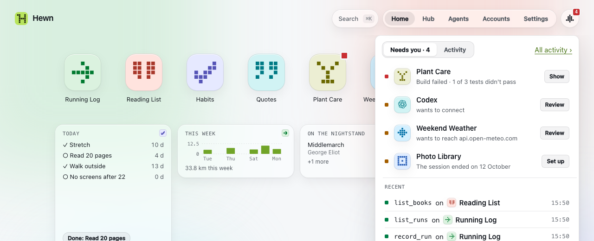
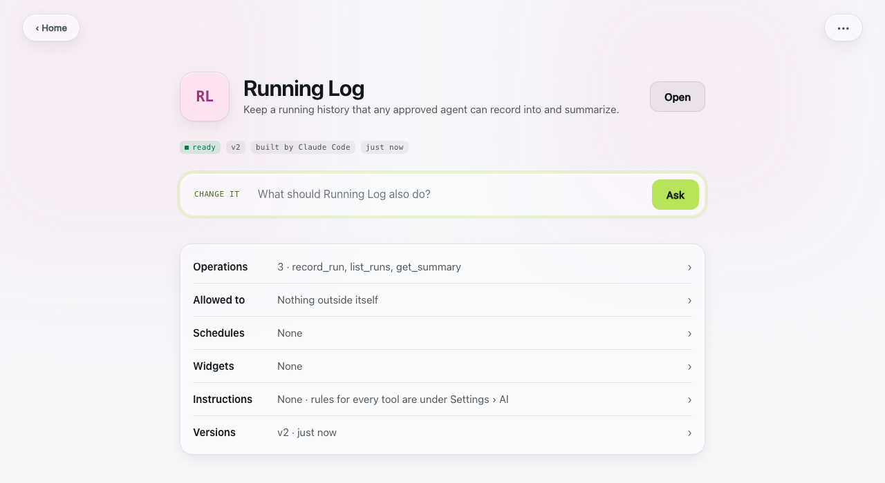
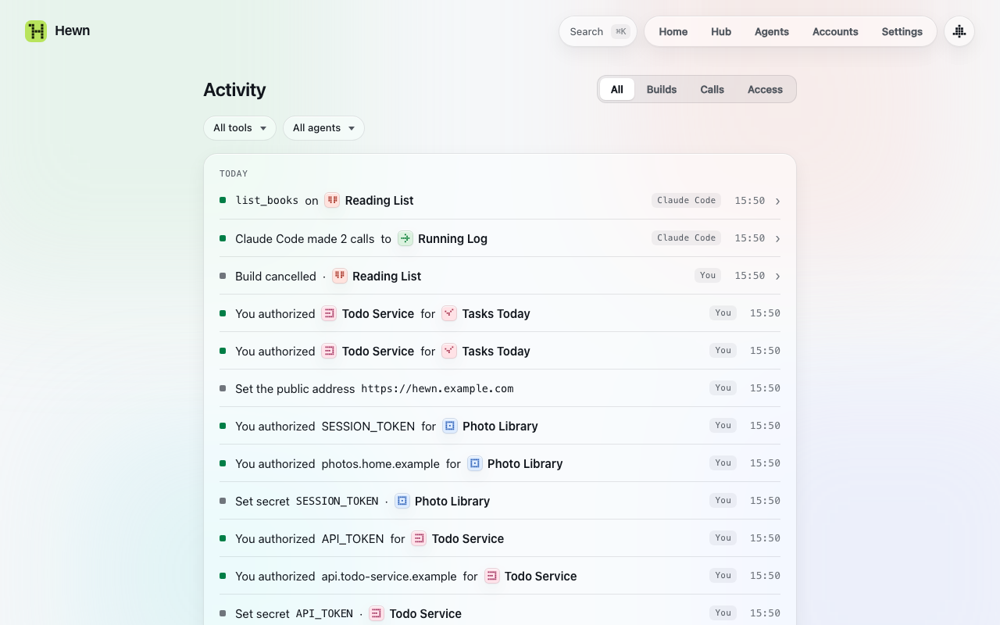
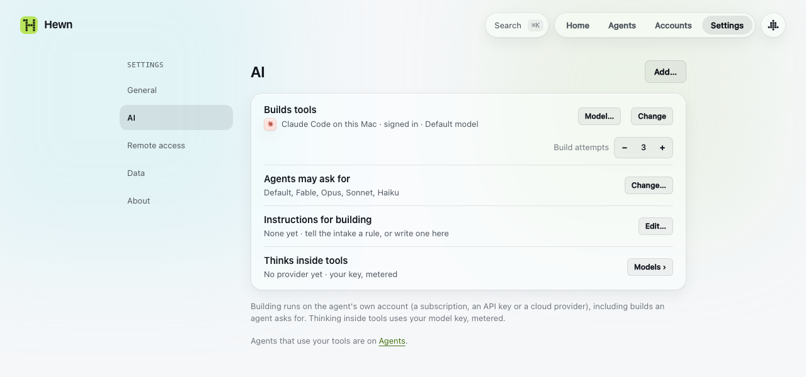
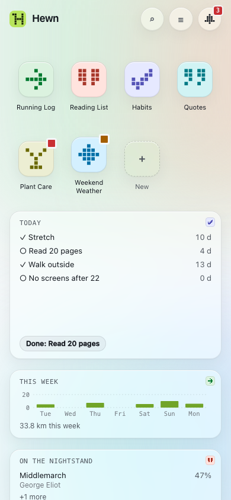

# The web client

`hewn open` opens Hewn in your browser, signed in. Hewn's web client runs only on the machine Hewn runs on, unless you've set up [a public URL](remote-access.md).

The top bar has Search, **Home · Agents · Accounts · Settings**, and the **Inbox** on the right.

## Home

Home holds your tools as icons, and the widgets you've put there. Click a tool to open it: its own screen if it has one, otherwise its operations as forms. The **New** tile asks for a new tool ([Building tools](building-tools.md)).

Right-click a tool for its menu:
- **Open**, **Change…** and **Info**
- **Widgets…**, **Activity** and **Versions…**
- **Rename**, **Set icon…** (draw a 5×5 glyph and pick its colour, or upload an image) and **Export data**
- **Delete…**

Right-click a widget for **Open**, **Refresh**, **Options…** (for a widget that takes options, such as which item to show: the same form as when you added it, with a preview), **Change…** and **Remove widget**.

**Edit Home:** right-click empty space and choose Edit Home, or press `e`. Drag tiles to move them. Tap a widget's size tag (S, M or L) to switch to its next size, or × to remove it. × on a tool hides it from Home: it's still in search, and **Show on Home** in its menu brings it back. **+ Add widget** shows every widget your tools offer, with a preview. **Done** (or Esc) saves.

A widget shows a tool's data at a glance: today's habits, tonight's aurora forecast, a quote. It refreshes by itself. When it couldn't refresh, it keeps the last view and says how old it is.

## Search and commands

Press `⌘K` (or `Ctrl K`, or `/`), or click Search. Type to find a tool, a page (Activity, Models, Backups…) or an action (New tool, Edit Home, Back up now…). Enter opens it.

## The Inbox

The **Inbox** button on the right of the top bar holds everything that needs you, with a count:
- tools waiting for your approval of what they need (a host, a key, another tool, a model)
- agents waiting to be approved
- schedules an agent proposed
- builds that failed
- connections that need you to sign in again
- model spend at 80% of your budget, or calls refused over it

Each row has one action. **Activity** in the Inbox shows what just happened, and builds in progress pulse.

One thing doesn't wait in the Inbox: when an agent calls an operation marked *destructive* (deleting runs, say), the agent is stuck until you answer. A banner shows on every page until you allow it once or stop it.

## A tool's page

**Info** (in the tool's menu) shows what the tool is for, what it can do, and rows for:
- **Operations:** run any operation from a form, and see its result
- **Allowed to:** the hosts, keys, other tools and model it may use, and what's waiting for you
- **Model:** which tier it thinks with, and its own monthly cap ([Models](models.md))
- **Schedules:** run an operation on a timetable
- **Widgets:** the tool's widgets, and deleting one
- **Instructions:** standing rules for this tool's builds ([Building tools](building-tools.md#instructions))
- **Versions:** every version, and restoring an earlier one ([Building tools](building-tools.md#versions))

The **Change it** box asks for a change ([Building tools](building-tools.md#changing-a-tool)).

**When something in a tool fails** (an operation in its own screen, a run from Info, a widget that can't refresh, a schedule's run), Hewn offers **Ask builder to fix this**. It opens a change to the tool with what failed already written in: the operation, the error, its input and the last log lines. Read it, add anything you know, and send it. Hewn keeps a tool's last ten failed calls for this.

### Schedules

A schedule runs a read or write operation hourly, daily, weekly or on a custom cadence, in your time zone (Settings › General). Info › Schedules lists them, with a switch each and when they run next. Add one at the bottom.

Agents can propose a schedule, but nothing runs until you enable it from the Inbox. A schedule that fails three times in a row pauses itself and says why. Resume it when it's fixed.

## Activity

Everything that happened, newest first: builds, calls, and access changes (agents approved or disconnected, grants, secrets, destructive calls). Filter by kind (All, Builds, Calls, Access), by tool or by agent. Press `a` to open it.

Builds show their milestones (spec, code, tests) as they happen. Open one to see its log. A failed build keeps its log open under the reason.

Call logs are kept for two weeks by default (Settings › Data).

## Agents and Accounts

- **Agents** lists the agents that use your tools, and the ones that work for Hewn. See [Connecting agents](agents.md).
- **Accounts** lists your connections to other services, and their health. See [Connections](connections.md).

## Settings

- **General:** appearance (system, light or dark), your time zone, and whether the sandbox is on.
- **AI:** who does [Hewn's two jobs](concepts.md#hewns-two-jobs) (builds tools, on which model, and thinks inside tools), which models agents may ask for, your [instructions for building](building-tools.md#instructions), and the Models page ([Models](models.md)).
- **Remote access:** the public URL, your passkeys and signed-in browsers ([Using Hewn from anywhere](remote-access.md)).
- **Data:** backups and their folder, how long call logs are kept, and deleted tools ([Your data](data.md)).
- **About:** the version, whether a newer one is out (with the command to upgrade), and shortcuts.

## On a phone

On a narrow screen, Home is a four-column grid, the menu folds into ☰ (the Inbox stays), and tools open full screen. The other pages work on a phone, but are laid out for a computer. To reach Hewn from your phone at all, see [Using Hewn from anywhere](remote-access.md).

## Shortcuts

| Key | |
| --- | --- |
| `n` | New tool |
| `h` | Home |
| `e` | Edit Home |
| `i` | Inbox |
| `a` | Activity |
| `b` | Builds |
| `g` | Agents |
| `u` | Accounts |
| `,` | Settings |
| `/` or `⌘K` | Search and commands |
| `?` | Shortcuts |
| `Esc` | Close a dialog, a menu or the Inbox |
